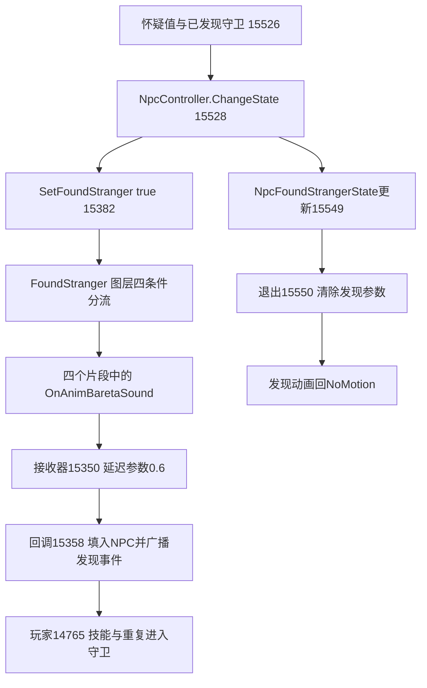

# AnimatorController 与发现/Sad 动画事件接线

本轮把原生参数写入、序列化 ControllerConstant、片段 AnimationEvent 和同物体接收组件连接起来。NPC `OnAnimBaretaSound` 对应四种发现动作；玩家 `OnEndSad` 对应 `Action.Sad`，随后可触发另一个图层的 `Upper.BaretaEscape`。这些是当前构建的静态接线与条件，尚未观察实际播放或回调。

原始输入仍为 `E:\SecretFlasherManakaREA`，不启动游戏、不改原始文件。原生/metadata 指纹沿用 `salt/evidence/artifact-identity.json`；原始 data.unity3d 与解密 models 指纹分别为 `20781bef…710ae93a`、`98621b2c…4308367`。

## 证据与解析范围

- `assets/npc-animation-events.json`：枚举原始 data.unity3d 内可识别 SerializedFile 的 357 个 AnimationClip、48 个 Controller、1,246 个 Animator，均消费至对象 EOF；GI/resource stream 等不透明节点列明排除。四个目标事件保存原始字节、字段跨度、片段起止时间、循环标志和对象身份。
- `assets/animator-wiring.json`：完整解析选定 Player/Npc ControllerConstant，保留两控制器原始对象、281 节点 donor schema、全部字段跨度、原始目的地/selector、参数/TOS、图层、状态、过渡与外部 clip 表。Player 有12图层/200个 clip 表项，Npc 有6图层/51个表项。图层/机器/状态/clip 表项索引各自独立，不能互换。
- 原始资源没有嵌入 type tree，采用本构建解密 models 自带 schema；先要求 engine=`2022.3.62f2`、classID、old_type_hash 匹配，再要求全对象 EOF。Controller hash=`fc82e38aa4ec91a42bead3793b8ad3a8`，AnimationClip hash=`b4377c9ecdec903d985ce3c669308faa`。JSON 明确区分原始对象与 donor 来源，未把 donor 说成原始资源自带的树。
- `salt/evidence/animator-chain.json`：新 REA 函数、复用旧观察、原始 IL2CPP 方法记录/参数/字段偏移/MethodSpec、81条 cctor 字面量→StringToHash→静态字段链接。数字 hash 来自控制器 TOS 同名记录，不冒充实际运行的 ICall 返回值。

条件模式名按 [Unity 2022.3 官方声明](https://github.com/Unity-Technologies/UnityCsReference/blob/2022.3/Editor/Mono/StateMachine.bindings.cs)解释：If=1、IfNot=2、Equals=6；对象布局来自 shipped schema。下面的 bool 条件“真/假”对应 If/IfNot；TransAction/BaretaEscape 的参数记录为 trigger。

## NPC：发现条件到事件与退出

资源控制器为 `resources.assets` pathID **1995**，名 `Npc`。FoundStranger 图层索引4，默认权重1，机器4默认状态0=`NoMotion`。四个动作的 AnyState 入口都要求 `IsFoundStranger=true`，再按下表分流：

| IsFemale | IsSit | 状态 / clip 名 | 状态索引 | clip表索引 → resources pathID | 事件时间 / 片段结束（秒） |
| --- | --- | --- | ---: | --- | --- |
| 真 | 假 | FoundStranger | 1 | 46 → 1532 | 0.666666687 / 0.833333313 |
| 假 | 假 | FoundStrangerMale | 2 | 47 → 1533 | 0.383333325 / 0.566666663 |
| 真 | 真 | SitFoundStangerFemale | 3 | 48 → 1554 | 0.666666687 / 0.833333373 |
| 假 | 真 | NpcSitFoundStangerMale | 4 | 49 → 1544 | 0.666666687 / 0.833333373 |

保留资源原名中的 `Stanger` 拼写。四个片段 start=0、loopTime=false；各有一个 `OnAnimBaretaSound` 事件，intParameter=10。原生15350的声明没有参数，因此不推断它读取了这个10。

四条入口都是固定时长0.25、HasExitTime=false、CanTransitionToSelf=false。四条出口均在 `IsFoundStranger=false` 时去 NoMotion，固定0.25、HasExitTime=false。字段里仍保存0.75、0.7、0.7916667等 ExitTime 数字；由于对应 HasExitTime 为假，不能把它们解释成实际等待比例。全部目标 state speed=1、speed parameter 为空。

原生接线如下，继续沿用 [Bareta 状态报告](bareta-chain.md) 中的检测/玩家守卫：



NpcAnimationManager 的 static `+0x24` 对应 IsFoundStranger，控制器 ID **3942153971**；15382将传入 bool 写到其 Animator。另 `+0x14` 对应 IsFemale（**1919607520**），`+0x38` 对应 IsSit（**1743140725**）。这些都是静态字段区偏移，不能当成 Animator 对象偏移。

15359 初始化把 nca.Animator(`+0x90`)保存到 manager.Animator(`+0x18`)，关闭 applyRootMotion，并把回调15403安排到 DelayFlame(1)。15488 构造在 NPC 模型对象上 `GetComponent<Animator>`，再对 Animator.gameObject `GetComponent<NpcAnimationEventReceiver>` 保存到 nca.`+0x98`；两次泛型参数有原始 MethodSpec 字节。15518初始化再把 nca 写入 receiver.`+0x20`。这是组件查找/字段初始化证据，不能由此声称运行 AddComponent。

15403回调先 Animator.Rebind(true)，再按 StateModel.AvatarType(`+0x4c`)等于0或4计算 IsFemale。它不是读取同模型的 isFemale 字段来设置该动画参数。SetIsSit（15387）直接把传入 bool 写入对应 Animator 参数；完整椅子/坐姿生产者仍超出本轮。SetSpeed（15367）写的是 manager.`+0x20` SmoothFloat 的目标字段`+0x1c`，15360更新后设置 MotionSpeed参数，不能由函数名推成全局 Animator.speed=0；发现时把此目标设0并不证明发现clip被暂停。

原始文件有 **10个序列化 Animator**直接引用 Npc1995，9个同物体有该 Receiver。例外 `Casual1`（GameObject17757、Animator26485）自身是根、序列化为active、Animator enabled=1，同物体只有 NpcAvatarComponent72409。它不是漏查父层接收器，但实际模型选择、运行添加/替换和转发仍未知；十个引用也不是运行NPC数量。

15350的 Scheduler.DelayScaledTime 参数0.6是事件触发之后的调度步骤。因此0.383/0.667不是发现广播的墙钟时间，不能直接与0.6相加后宣称某时刻必然发现玩家。图层、全局动画速度、timeScale、剔除、过渡中断及NPC实际实例都会影响是否/何时收到事件。

## 玩家：Sad 的选择、事件与后续图层

Player 控制器在 models 主节点，pathID **-1824587515900773540**。models 内6个 Animator 直接引用它，六者同物体均有脚本类 `PlayerAnimationReceiver`；MonoScript资源名为 `PlayerAnimationEventReceiver`，以解析到的类身份为准。这是六个序列化引用，不能推导同时存在六个玩家。

PlayerAnimationManager.Initialize（14525）从 pca.Animator(`+0x10`)取得 Animator，保存到 manager.`+0x30`。TransAction（14536）依次写旧动作 `OldActionId`、新 `ActionId`，再 SetTrigger(`TransAction`)，最后更新自身旧动作记录。cctor14553绑定：ActionId静态`+0x1c`、字段名Action的`+0x20`实际字面量为TransAction、BaretaEscape静态`+0x44`。

| 控制器路径 | 入口条件 | state / clip表索引 | 出口 |
| --- | --- | --- | --- |
| Action.Bareta | IsBareta=true | 2 / 38 | IsBareta=false → NoMotion，无 exit wait |
| Action.Sad | ActionId=10018 且 TransAction | 14 / 50 | NoMotion，HasExitTime=true，ExitTime=0.9025974274 |
| Action.HandcaffsAtMapSad | ActionId=6 且 TransAction | 27 / 63 | HandcaffsAtMapCry(26)，同上 exit 比例 |
| Upper.BaretaEscape | BaretaEscape trigger | 1 / 169 | 该state序列化 outgoing为空；保留同机器 AnyState/selector 原始数据，不据此断言永远不能退出 |

以上入口 HasExitTime=false、固定过渡0.25；Sad/手铐Sad/BaretaEscape可自过渡，Bareta入口不可。Action图层1和Upper图层5默认权重均1，它们是不同图层，因此“触发Escape”不能画成 Action.Sad 到 Upper.BaretaEscape 的同机器直接过渡。

GameOverController.StartSadCharacter（16685）写外部 TransAction=10018 → Bareta.OnUpdate（14570）→ PlayerAction.ChangeAction → AnimationManager.TransAction（14536）→控制器进入 Sad。地图手铐头部反应分支改用ActionId=6，命中另一状态和另一clip，不能并入普通Sad事件。

clip50解析为实际 `Sad`（pathID **-4167274116460597170**），start=0、stop=**2.5666668415**、loopTime=false，只有一个 `OnEndSad`，时间 **2.2666666508**。在 state speed=1、无速度参数且无其他影响的 clip 时间域下，出口比例乘片段时长约 **2.316666888**，比事件晚约 **0.05000024**。这解释配置上回调位于退出混合开始前，并不是测得的墙钟顺序；事件名也不表示片段末尾。

OnEndSad（14504）先处理电梯 PushBounds 分支（TransAction动画4=CrouchCry并返回）、CurrentAction=6早退。其余路径才 ChangeState(2)、触发 BaretaEscape（14537，ID **1153629078**）、目标移动动画速度2、关闭角色碰撞、启用NavAgent位置/旋转更新并设逃跑目标。随后 Upper 层的 AnyState 条件可选中 clip169=`BaretaEscape`。Action层自己的 Sad→NoMotion 出口与这个上层动画同时构成接线；没有证据说动画过渡本身调用 ChangeState(2)。完整导航/失败加载条件见旧报告。

models 260个 clip 的旧完整事件扫描中，OnEndSad仅此一处；本轮357个原始 clip 的事件扫描补上了先前缺失的NPC四处。已确认的有限范围不能外推为所有运行创建/覆盖动画均已穷尽。

## 复核与剩余边界

新批次保留计划、种子、REA完整导出、逐函数JSON/伪代码及关闭状态；旧事件/状态函数复用已有观察，不重复计数。独立复核对两个控制器原始对象重新核对14,928个叶字段、四条NPC条件/clip映射、Sad出口和六个玩家Receiver引用。

新增13次非空REA查询：animator-parameters 7、animator-component-wiring 3、animator-npc-parameters 3，均正常结束并关闭会话。关键观察如下：

| 方法 | Evidence ID |
| --- | --- |
| 15382 SetFoundStranger | `ev_d726d1ee403cbd204955ddbe0f5a8f851572ded13b1599c14318612f6d74751e` |
| 15403 Initialize延迟回调 | `ev_6daba0c4859ba8787825c5b19c7acdfb46668eff85e22d2789d108b0fc24bfd7` |
| 15387 SetIsSit | `ev_4d3d81dd24d6f68fd81b8f5e0f1ee9a1b46f2a9190387b84412a7b72ddb9da51` |
| 15488 组件查找 | `ev_97b2128a6717fb9d079d421a13b54405189ce1fa3156717e99fdbd057d908de3` |
| 15518 接收器初始化 | `ev_45e98d0357cf584aacb8492954e493e3db696d6e04395bc43abfd2bb1e68df0d` |
| 14536 TransAction（复用） | `ev_2ec527e91f511d33e0dad0d7a6e4b825b5a32800b2c63e86957b7c1c9a22e7db` |

```powershell
python reverse-engineering/assets/inspect_npc_animation.py --check
python reverse-engineering/assets/inspect_animator.py --check
python reverse-engineering/salt/animator_evidence.py --check
python reverse-engineering/audit.py --inputs
```

仍需进一步确认运行NPC模型选择/覆盖控制器、Casual1接收器来源、NpcAnimatorFpsController的剔除/调帧影响、所有过渡竞争/selector特殊目标以及实际回调顺序。当前成果可用于重建选定状态和事件配置，尚不能替代完整GameAssembly或证明游戏能独立运行。
