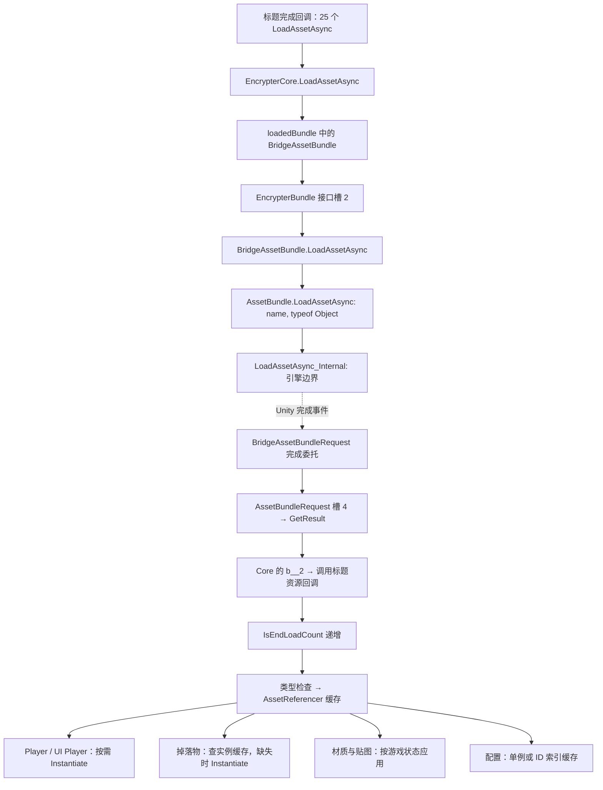

# EncrypterBundle 分派、25 个完成回调与资源消费者

本轮沿同一 SHA-256 的原始 `GameAssembly.dll` 继续静态 REA/Ghidra 分析。新增 **56 份非空原生观察**，另保留 **3 份空 Listing 响应**作为工具覆盖限制；后者不作为指令证据。未运行游戏或调用游戏 DLL。

完整坐标、Evidence ID、25 项资源映射和消费者链接在 [`salt/evidence/asset-followup.json`](salt/evidence/asset-followup.json)。所有本轮原生记录位于 `salt/evidence/asset-*/`；复查脚本为 [`salt/asset_evidence.py`](salt/asset_evidence.py)。

## 从接口请求到 Unity 获取结果



虚线是未执行的运行时事件关系；其余为本轮静态代码和原始表记录支持的调用/数据关系。引擎实现位于 Unity 的原生侧，本轮止于具名 ICall，不把它当作已反编译的 `UnityPlayer.dll` 实现。

### 接口槽已解析

原始 metadata 中 `EncrypterBundle` 是接口（typeID **9783**，flags **0xa0**）。非泛型 `LoadAssetAsync(string)` 的 methodID **76264**、接口槽 **2**。

全 **10,508** 个 typeDef 的接口偏移表中，只有 **BridgeAssetBundle / typeID 9778** 实现此接口，其 interfaceOffset 为 **4**。因此接口槽 2 对应类 vtable 槽 **6**。该项原始 uint32 **`0x60025389`**，按 v31 编码规则解为 methodID **76228**，VA **`0x181433c90`**。泛型重载是另一槽，不能互换。证据见 `salt/symbols/dispatch-metadata.json`。

接收对象也有独立证据：包加载完成回调在 `FUN_1802c43a0` 处分配的 TypeInfo usage **`0x182d64c98`**，原始编码 **`0x20006b3b`**，经过注册表的 runtime typeIndex **13725** 指向 **BridgeAssetBundle**。它包住引擎返回的 AssetBundle，随后写入包缓存。

**更正上一轮的类型解释：**地址 `0x18048d520` 被 33 个元数据方法共享。旧 Ghidra 种子把这里显示为 `EncryptLabelData::.ctor`，不能据此认定实际对象为 EncryptLabelData。本轮依据 TypeInfo 和字段表确认对象为 BridgeAssetBundle：`+0x10 assetBundle`、`+0x18 labelName`。原始伪代码与 Evidence ID 保持原样，文档中的解释已更正。

### ABI 与非空 Listing 的边界

Core 在 `0x18143956c` 调用 `0x18001f490` 前，有 `mov r9,rbx`、`mov r8,rdi`。该跳板查 EncrypterBundle 接口表；找到项后按 `interfaceOffset + 2` 定位 VirtualInvokeData，未找到时进入同槽的运行时解析辅助函数。

跳板尾部把接收者放入 RCX、名字放入 RDX、方法信息放入 R8，再跳到解析出的入口。这里使用原始 PE 字节的 Iced 解码补齐 Ghidra 错误/不完整的参数显示，相关指令窗口、字节与文件偏移在 `instantiation-generics.json::iced_dispatch_abi_observations`。三个 REA `procedure_assembly` 响应为空，不能声称这些寄存器来自该空响应或来自运行时采集。

### 25 项实际走普通资源分支

`BridgeAssetBundle.LoadAssetAsync` 检查资源名中的 `>`。存在该分隔符时走 sub-assets 请求与筛选；本批 25 个名字都没有 `>`，因此全部走普通 `AssetBundle.LoadAssetAsync(name, typeof(UnityEngine.Object))`，原生 wrapper 最终解析：

```text
UnityEngine.AssetBundle::LoadAssetAsync_Internal(System.String,System.Type)
```

Core 先把名字转小写；表格保留调用点原始大小写，实际传给引擎的名称另存在 JSON 的 `engine_name_after_lowercase`。名字中写着 Texture 的资源不一定是 Texture，类型来自回调检查和字段声明。

`BridgeAssetBundleRequest` 保存 AssetBundleRequest 并转接 Unity 完成事件，其 `<.ctor>b__30_0` 取得结果后调用插件 `completed`。Core 对本批无 `>` 的请求设置的是 `<LoadAssetAsync>b__2`，再把得到的 Unity Object 交给标题对应的 Action。

取结果处的虚拟调用不是未知槽：class vtable 基址 `+0x138`，取 `+0x178` 即槽 **4**；AssetBundleRequest 的该槽解为 **GetResult / methodID 78749 / VA `0x181ef2f90`**。REA 确认它解析 `UnityEngine.AssetBundleRequest::GetResult()` ICall。构造函数还存在 `isDone` 时立即调用的分支；本轮没有执行应用来证明它与后续 `completed` 赋值的实际时序。

## 25 个完成回调写入哪里

已定位 MetadataRegistration **`0x1828d02c0`**，并重读全部 **10,508** 个字段偏移行。原始字段名与实际偏移的结合保存在 `salt/symbols/field-offsets.json`。这次使用的是原生字段偏移，不再依靠包装器属性顺序猜测。

回调 methodID 从 **16377** 到 **16401**，均先把 `TitleSceneView.IsEndLoadCount`（实例 `+0xb4`）加一，再检查类型和写缓存。计数递增发生在检查/写入之前，不等于资源成功加载的断言。缓存持有原始包资源引用；这些回调中没有直接实例化 GameObject。

以下字段均位于 `AssetReferencer.instance`；数组括号为真实元素索引。

| # | 请求名称 | 回调接受类型 | 缓存目标 | 后续消费者 ID |
| --- | --- | --- | --- | --- |
| 1 | DildoFloor | GameObject | MultipleDroppedPrefabs[0] | 16710 |
| 2 | DildoWall | GameObject | MultipleDroppedPrefabs[1] | 16710 |
| 3 | DroppedCoat | GameObject | DroppedPrefabs[0] | 16710 |
| 4 | DroppedHandcuffKey | GameObject | DroppedPrefabs[5] | 16710 |
| 5 | DroppedVibeRemocon | GameObject | DroppedPrefabs[6] | 16710 |
| 6 | Player | GameObject | Player | 16862 |
| 7 | Sweat Texture [Less] -Selestia- 1 | Material | SweatBody | 14624 |
| 8 | Selestia_body_Inmon | Material | Inmon | 14623 |
| 9 | Selestia_bodyRakugaki | Material | Rakugaki | 14623 |
| 10 | Selestia_bodypaint | Material | ClothesPaint | 14624 |
| 11 | Selestia_body_DarkTatto | Material | TattooDark | 14623 |
| 12 | Selestia_body_Flower1 | Material | TattooFlower1 | 14623 |
| 13 | Selestia_body_Flower2 | Material | TattooFlower2 | 14623 |
| 14 | Selestia_body_Lotus | Material | TattooLotus | 14623 |
| 15 | Selestia_body_Satanism | Material | TattooSatanism | 14623 |
| 16 | Selestia_body_Slave | Material | TattooSlave | 14623 |
| 17 | Selestia_bodyRubberSuit | Material | RubberSuit | 14623、14624 |
| 18 | otinpov3_texturePaint | Material | FutanariPaint | 15066 |
| 19 | otinpov3_texture | Material | FutanariMaterial | 15066 |
| 20 | otinpov3_Rubber | Material | FutanariRubberMaterial | 15066 |
| 21 | BodySuit_Non NP_Black | Texture | RubberSuitBlack | 14627 |
| 22 | BodySuit_Non NP_Black1 | Texture | RubberSuitWhite | 14627 |
| 23 | MCustomizeColor | MCustomizeColor | MCustomizeColor | 16265 |
| 24 | MHair | MHair | MHair | 16087 |
| 25 | SimpleManustia | GameObject | UiPlayer | 13846 |

其中 GameObject **7**、Material **14**、Texture **2**、配置对象 **2**。每一行均有调用点 literal、delegate usage、回调 VA/Evidence ID、缓存偏移和消费者 Evidence ID，可从机器索引复查。

## 实例化、实例缓存与其他资源使用

### Player

`InGameManager.Start`（**16862 / `0x180495dc0`**）读取 `AssetReferencer.Player +0x348`，以当前管理器 Transform 为父节点调用 `0x1809f1050`。

原始 methodSpecs / genericInsts / type_argv 证明 usage **`0x182d54d90`** 是 `Object.Instantiate<GameObject>(original,parent)`。REA 跟到非泛型三参 `Object.Instantiate`，在有效父节点分支解析 **`Internal_CloneSingleWithParent`**，没有父节点时另走 `Internal_CloneSingle`。

随后 usage **`0x182d5abb8`** 对应 `GetComponent<PlayerController>()`，泛型 helper 经过 **`GameObject.GetComponentFastPath`** 引擎接口取组件；不能把 Ghidra 将地址写回结果误显示为 `return 0` 解读为组件恒为空。得到的组件写入 `InGameManager.<InGameReferencer>k__BackingField +0x28` 所指对象的 `<Player>k__BackingField +0x30`。原始预制体缓存与生成的 PlayerController 是两个存储位置。

这里另有原始机器码核对：helper 在 `0x1809a09ac` 调用 FastPath 后，`0x1809a09b1` 执行 `mov rax,[rsp+20h]` 再返回，没有将返回寄存器强制清零。完整 51 条有界 Iced 指令在 `instantiation-generics.json::get_component_return_abi`；FastPath 对栈中结果位置的具体写入契约尚未单独解析。

### 掉落物

`DroppedItemManager.GetCache`（**16710 / `0x180488a50`**）使用 `cache +0x10` 字典。已有且仍有效的 Unity 实例会被复用；无效项被移除。没有缓存项时：

1. ID 小于 10000，取 `DroppedPrefabs[id]`。
2. ID 大于等于 10000，取 `MultipleDroppedPrefabs[id / 100 - 100]`。
3. 调用同一 `Instantiate<GameObject>(prefab,parent)`，从实例取 `DroppedItemController`，调用 `Initialize(id)`，再按 ID 写入实例缓存并返回。

五个标题预制体因此分别进入这两组数组，不能把数组槽号直接当成完整物品 ID。`GetComponent` 的 T 来自 usage **`0x182d5dfa8`**，原始命名空间拼写为 `ExposureUnnoticed2.Object3D.DropedCoat.DroppedItemController`。

### UI Player

`UiPlayerController.Initialize`（**13846 / `0x1805eb800`**）读取 `UiPlayer +0x350`，即 `SimpleManustia` 的缓存资源，在自己的父 Transform 下克隆，取得组件并保存到控制器字段，最后调整 UI 对象激活状态。这是预览角色实例化，不是再次发起资源包解密。

### 材质、贴图和配置

- `PlayerBodyMaterialController.TransToMaterialAsset`（**14623**）按状态枚举返回缓存材质；`SetupBodyPaintFromGameState`（**14624**）结合 ClothesPaint、SweatBody 等更新 Renderer 材质数组、颜色/贴图；`ApplyFromGameState`（**14627**）使用 RubberSuitBlack/White 贴图与状态设置。已有 REA 记录包含 `GetMaterialArray`、`SetMaterialArray`、Material 的颜色与贴图接口。没有把这些引用描述为新建 GameObject。
- `FutanariController.SetupPaint`（**15066**）选择 FutanariPaint/Material/RubberMaterial 并应用相关材质属性。这里是本批三个缓存材质的消费者，不是额外的包加载入口。
- `MCustomizeColor.get_Instance`（**16265**）在单例缺失时从 AssetReferencer `+0x30` 写入静态单例。
- `MHair.CheckInitialize`（**16087**）在静态字典未建立时读取 AssetReferencer `+0x68` 的配置列表，按条目 ID 建立索引。它缓存配置条目，不创建角色对象。

上述消费者均已执行针对性 REA 反编译，而不是仅依据 Iced 的名称/字段候选推断。各场景是否实际进入分支、对象是否为空、所有材质排列与游戏状态组合的结果仍属于运行时或更大范围验证。

## 证据与复现

主要接口观察：Bridge `ev_7c26c06d0fb61d4ec6743c0083e0cb7eac5eababc3991ae0c895f4ac0ea7a96e`；Unity LoadAssetAsync `ev_0abd5321e0baffbb595bbecda84cd9ca10a35b08711f53bb0b647e6096ccc601`；GetResult `ev_b3008e92c6262929f5cbc834f485f12348a841c50053fedb312e46cc6035f840`。

主要实例化观察：GetCache `ev_2c3c0aa0cdf690cba508fea7ce658a4a06e2b202258d9d2fbf34954dde0476ae`；InGame Start `ev_b99f603049900a7a375e4b4105d5e447e6cbc7838d78d3c2904b2fd51e2ec841`；UiPlayer Initialize `ev_e5a77520c8f98f4f9764a16f2f9cf5bd300c2e650d872a3e7d55acf08a068d77`。

```powershell
# 使用已有原始输入；若方法索引缓存缺失，先执行 metadata.py index
python reverse-engineering/salt/asset_evidence.py --check
python reverse-engineering/salt/loading_evidence.py --check
python reverse-engineering/audit.py --inputs

# 复查原始观察无需重新启动 Ghidra。
# 需要重新分析时，使用 salt/symbols/asset-*.plan.json；迁移绝对路径需重新生成计划。
node reverse-engineering/salt/run_batch.mjs reverse-engineering/salt/symbols/asset-dispatch.plan.json
node reverse-engineering/salt/run_batch.mjs reverse-engineering/salt/symbols/asset-callbacks.plan.json
```

`asset_evidence.py` 会重读全部字段偏移、关键 vtable、原始 usage/literal、泛型和 Iced 指令字节，并把 25 个回调与准确字段、消费者证据关联。重新运行原生分析后要审阅并更新绑定与总证据索引。没有声称恢复全游戏原始 C#、穷尽所有缓存读取点、完成全部对象销毁/卸载路径，或观察到本轮实际加载与实例化成功。
