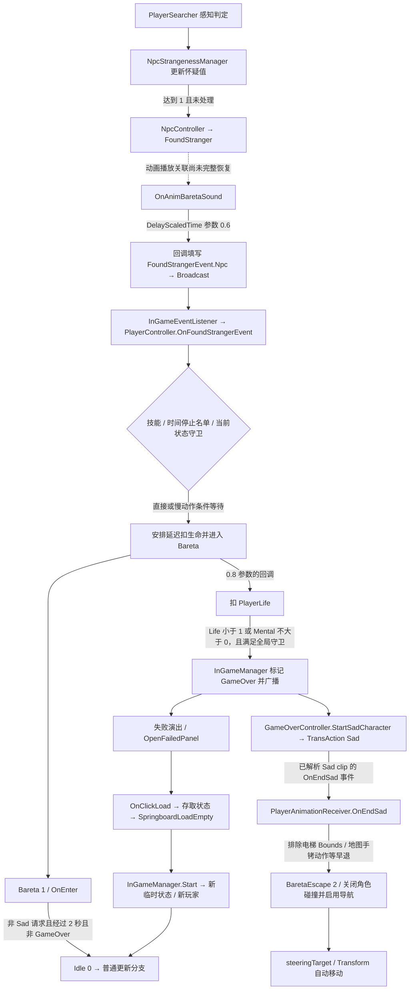

# 被发现、Bareta/BaretaEscape 与普通操作恢复

后续补充：[Animator接线报告](animator-wiring.md) 已解析原始资源中NPC四个OnAnimBaretaSound事件，连接选定Player/Npc控制器条件、片段、接收器与Sad/BaretaEscape图层。本文下方“本轮”及NPC接线未解析描述是上一阶段的证据边界；更新后的结论以该报告与unknowns.json为准，实际运行仍未验证。

本轮已连接发现通知的原生生产者、玩家反应、延迟扣生命、GameOver、Sad 动画结束、自动逃跑和失败后加载。新增 **8 批、77 次非空 REA 查询、77 个地址**，含 2 个无 metadata 方法指针的数学辅助地址；复用 13 份既有观察。原始输入固定为 `E:\SecretFlasherManakaREA`，REA 6.5.0 / Ghidra 12.1.4，会话均已关闭，未运行游戏。

核心区别：普通 Bareta 反应可以在约 2 秒后回到 Idle；本轮确认的另一条路径经 GameOver/Sad 进入 BaretaEscape，它属于失败演出中的自动移动，不能等同于逃脱成功或恢复玩家控制。恢复还涉及动作、碰撞、导航、临时状态与重新加载。

原始 REA 与字段坐标汇总：[bareta-chain.json](salt/evidence/bareta-chain.json)。原始枚举和配置：[bareta-config.json](assets/bareta-config.json)。发现事件生产者的机器指令及真实动画事件：[bareta-producer-candidates.json](salt/symbols/bareta-producer-candidates.json)。这些是静态证据，完整 Animator 播放选择和实际事件时序仍有边界。

## 1. 总体关系



虚线明确保留 NPC Animator→clip 的未决关联；GameOver 演出中各入口的时间顺序也不由图中的箭头证明。事件广播监听器的实际执行顺序未观测。

## 2. 感知、NPC 发现状态和玩家反应是三个层次

`PlayerSearcher.ForPlayerUpdate`（15644）先清除 IsPlayerFound，再结合子检测区域、朝向点积、玩家缓存位置/暴露部位和射线命中对象决定是否置位。`NpcController.get_IsPlayerFound`（15511）读的正是该感知标志；它本身不等于怀疑值已经到 1。OnUpdate（15643）还处理检测器位置、启停与轮询节流，不应把任意触发器接触都重写成一次“正式被发现”。

`NpcController.OnUpdate`（15524）更新 PlayerSearcher 与 NpcStrangenessManager。后者（15623）根据玩家行为计算增量、更新 StrangenessValueManager，并处理自己的 NPC 转向等分支。`ChangeFoundStrangerIfInCondition`（15526）在 Value `>=1.0` 且 `IsAlreadyFoundStranger=false` 时才使 **NPC** 进入 FoundStranger=1，并设置已处理标志。NPC 的状态枚举与玩家的 Bareta 枚举分属不同类型，即便数值同为 1 也不能互换。

NPC FoundStranger 的进入/退出（15548/15550、15528 中的内联部分）设置/取消发现动画。退出时清怀疑值并把衰减等待计数写为 `0x78`；StrangenessValueManager.OnUpdate（15693）按调用标志递减该计数，负值时才按 deltaTime 衰减，故这里的 120 不能解释成 120 秒。NPC 反应更新（15549）还有约 3 秒的计时及恢复原 NPC 状态分支；这不是玩家约 2 秒的 Bareta 反应计时。

真正的通知生产者是 **NpcAnimationEventReceiver.OnAnimBaretaSound（15350）→ 延迟回调 15358**：前者建立委托并传入 DelayScaledTime 的 0.6 参数，同时处理声音；回调从 NpcComponentAccessor 取得 NpcController，写入 `Events.FoundStrangerEvent.Npc`，再进入 EventManager.Broadcast 的分发逻辑。

生产者证据同时保留 REA 和 13 条 Iced 原始指令观察。`Events` 的原始 TypeInfo usage 为 `0x182d58080`；静态字段 FoundStrangerEvent 偏移 `+0x28`，事件的 Npc 引用是 `+0x10`。原始机器码在 `0x18041a972` 尾跳到 Broadcast（`0x1804b1f70`）；因此单纯扫描 E8 CALL 会漏掉这一跳。验证脚本核对保存的机器码，不将字节匹配伪称为再次反汇编。

## 3. 玩家进入 Bareta 的条件与延迟

`InGameEventListener.OnFoundExposureEvent`（16827）通向 `PlayerController.OnFoundStrangerEvent`（14765）的内联逻辑，后者负责以下路径：

1. 有效的被动技能 21/22 会直接返回；已在时间停止发现名单中的 NPC 也有跳过路径。这些是实际入口守卫，不应仅用名称相似的 `PlayerFacade.IsIgnoreBaretaState`（14806）替代全部逻辑，它们的具体判断并不完全相同。
2. 如果 BaretaState.FoundNpc 为空才记录本次发现者。随后若玩家已经在 Bareta=1 则返回，所以它不是每次事件都会替换发现者并重置反应。
3. 没有 AutoBaretaSlow=12 时，调用局部辅助 Action（14770），再请求 `ChangeState(1)`。
4. 有该技能时，把回调 14771 和条件 14775 交给 Scheduler，模型保存 10.0 的参数。14775 检查的是 `SlowAssistManager.currentState(+0x58)==0`；不能简化为“固定延迟十秒”。14771 被调度后会执行同一辅助 Action 并进入 Bareta；它的保存函数体没有重新验证入口的所有技能/名单守卫。

14770 创建约 0.8 参数的延迟模型，委托绑定 14774；该回调将 `GameStateData.PlayerLife(+0x1bc)` 减 1 并下限夹到 0。另已解析 `MentalManager.ReduceByFound`（14453）→ 回调 14457 的辅助入口：在其入口守卫满足且被调用时，延迟扣除 `MCommon.pulseMentalReduce(+0x74)=0.2`。本报告不把这两个不同的扣减路径合并，也不宣称已列完精神值辅助入口的所有调用者。

原始枚举恢复结果：PlayerState 为 Idle=0 / Bareta=1 / BaretaEscape=2；NPC State、SkillType、LookAtLayer、DifficultType、GameOverStagingState、StageType 的选定枚举也有逐字节来源。

## 4. Bareta 的进入、更新与退出

| 运行时对象 | 原生字段偏移 | 含义 |
| --- | --- | --- |
| PlayerClassAccessor | `+0xe0` / `+0xe8` | BaretaState / BaretaEscapeState |
| PlayerBaretaState | `+0x10` / `+0x18` / `+0x20` / `+0x28` | FoundNpc / IsOnlyHeadReaction / pca / enterTime |
| PlayerStateModel | `+0x5c` / `+0x48` / `+0x234` | CurrentState / CurrentAction / 外部 TransAction 请求 |
| TemporaryInGameState | `+0x11` | IsGameOver |

两个状态都是运行时普通类。`PlayerController.ChangeState`（14759）离开旧 Bareta 时执行退出清理，再写新状态；新 Bareta 会调用 OnEnter（14571）。进入时配置 NavAgent areaMask（选定关卡使用 mask=8，其余默认 -1），关闭当前 Ecstasy 动画标志。此函数没有一般性的“新旧相同则忽略”守卫：直接重复 ChangeState(1) 可以先退出再重新进入，重设 enterTime；入口事件处的“已经 Bareta 就返回”是另一层守卫。

OnEnter 记录 Time.time、清目标移动速度和蹲姿等。普通反应设置 Bareta 动画，头部反应则看向 FoundNpc 的眼部并使用 LookAtLayer.Bareta=7 与 BaretaFace。`PlayerIsAttachMapHandcuffs(+0x1a9)` 会强制头部反应，不能泛化为“任意手铐”。还可见表情/手臂目标及 PlayerEcstasy 的相应清理。

OnUpdate（14570）有两个必须区分的分支：

- 若外部 `TransAction==Sad(10018)`，关闭 Bareta/BaretaFace，调用 PlayerAction.ChangeAction；头部反应使用 SadHandcuffAtMap=6，其他使用请求的 Sad。它还关闭 LookAt7，但该分支本体不直接返回 Idle。
- 否则，当 `Time.time-enterTime>=2.0` 且未 GameOver 时请求 ChangeState(Idle)。非头部反应还计算朝向发现者的旋转；头部反应有自己的早退。不能把“2秒自动恢复”套到 Sad 或 GameOver 的所有路径。

OnExit（14572）与 ChangeState 中对应内联清理一致：取消 Bareta/Face，恢复 `TargetArmLayerWeight=1`，把 CurrentAction 直接写为 `MAction.Get(None=-1)` 或地图手铐对应 `HandcuffsAtMap=10021`，关闭 LookAt7、清 IsOnlyHeadReaction。这里是直接替换动作记录指针，不等同于调用 PlayerAction.ChangeAction，也不宣称恢复所有 UI/交互权限。

正常恢复最终依赖控制器再次命中 Idle 分支；普通 Locomotion.OnUpdate 与固定更新还要求非 GameOver。上一轮的 [玩家调用链](player-chain.md) 保留这些输入/物理守卫。

## 5. 进入 BaretaEscape 与自动移动

既有 `InGameManager.OnUpdate`（16864）在 PlayerLife<1 或 PlayerMental<=0、非 Apartment、尚未 GameOver 等条件满足时设置 IsGameOver 并广播 GameOverEvent。`GameOverController.OnGameOverEvent`（16681）处理扣除/任务/状态/保存与演出启动；StartSadCharacter（16685）写入 TransAction=Sad，接到上节的 Sad 分支。相关结算不等于普通 Bareta 的超时恢复。

**OnEndSad（14504，0x18062bc50）是本轮确认的 BaretaEscape 入口。** 它先检查特殊分支：若角色位于 ElevatorController.PushBounds 内，切换 CrouchCry=4 的动画并返回；CurrentAction 为 SadHandcuffAtMap=6 时也直接返回。通过这些早退后，才执行：

1. `PlayerController.ChangeState(2)`；触发 BaretaEscape 动画 trigger，目标移动动画速度设为 2.0。
2. 关闭 pca.CharacterController 的 Collider.enabled。
3. 启用 NavMeshAgent，设置 updatePosition/updateRotation=true。
4. 取得 StageController.GetEscapeTarget 并设置导航目的地。

原始解密 models 的 `Sad` AnimationClip（pathID `-4167274116460597170`，30,880B）按其嵌入的 **529 节点 type tree** 完整解析至 EOF，只有一个事件：`OnEndSad`，时间 **2.2666666507720947**。这是实际 AnimationEvent 字段解析，不是函数名字符串命中。全部 260 个 models clip 也逐个解析至 EOF，OnEndSad 共1处，OnAnimBaretaSound 为0处；后者的资源接线仍可能位于原始 data.unity3d、其他包或运行创建内容，限定搜索不能外推否定。

BaretaEscape.OnUpdate（14563）读取 steeringTarget，计算目标朝向并用数学辅助函数及 `400*deltaTime` 参数旋转；沿自身 forward、以 MCommon.playerJogSpeed（基础2.4）和 deltaTime 更新 Transform.position。方向比较辅助返回值>70 的分支将速度乘0.3。还会重新设置逃离目的地和 NavAgent.nextPosition。它没有直接读取 WASD，也没有在该保存函数体中检查到达后就切回 Idle 的分支。

GetEscapeTarget（16938/17060）取的是 PortalManager 目标集合的**首项 Transform**，不是 GetNearPortal（16941）的最近距离选择。此处没有自行选择“最近安全出口”的证据。

恢复不能只写 CurrentState=0：入口还关闭了角色碰撞、启用了导航更新位置/朝向；ChangeState 的新 Idle 分支本身没有统一反转这些 Escape 副作用的代码。另 PortalController.OnTriggerEnter（14398）在 GameOver 时直接返回，因此不能从自动跑向门口推导“触发传送门就逃脱成功”。本轮确认的是失败演出中的一条自动逃跑入口；不据此声称排除了所有其他调用者/Mod 路径。

## 6. 失败加载与另一个紧急逃脱功能

失败面板 OnClickLoad（17822）建立 WaitSceneLoadTwiceStarter，纯黑回调 17830：收集掉落物、调整衣物状态、调用 SaveManager.Save/Load（参数分类数值3），停止状态应用后广播清理事件，再安排一帧延迟的回调 17831。后者加载 `SpringboardLoadEmpty`，连接既有 [场景进入链](scene-chain.md)。完成回调 17832 清理提示用的静态标记。

InGameManager.Start（16862）重新分配 TemporaryInGameState，再克隆并初始化新玩家。新状态构造（17096）显式设置 IsFirstLoadStage=true；新玩家状态构造（14968）初始化其他字段和 TransAction=-1，**都不是直接写 IsGameOver=false/CurrentState=Idle 的赋值代码**。恢复到这些零值依赖新对象的零初始化及后续未覆盖字段，属于结合分配/构造/字段类型得到的静态推断，未运行验证。PlayerClassAccessor 构造（14714）、StateModel.Initialize（14964）与 Locomotion.Initialize（14894）提供新玩家及导航初始配置，区别于继续使用被关闭碰撞的旧 Escape 对象。

系统菜单的 OnClickEmergencyEscape（17495）是另一个功能：确认/延迟/淡出回调 17503–17505 等经 TransStageIfInCondition 进行关卡恢复及存取状态。PlayerController.OnEmergencyEscape（14764）本体只在相应手铐处理状态允许时设置处理标志，没有 ChangeState(BaretaEscape)。名称中都有 Escape，不代表这些路径就是同一状态迁移。相关菜单后续、场景切换函数及普通传送门条件分别保留原始代码，未将所有分支简化成一个成功结果。

## 7. 证据范围与复核

77 次查询的分组：bareta-core 10、bareta-detection 14、bareta-escape-route 15、bareta-discovery-transition 6、bareta-recovery 11、bareta-event-contract 13、bareta-animation-exit 5、bareta-notification 3。每批计划/种子在 salt/symbols，原始 JSON、伪代码、完整导出和成功关闭状态在 salt/evidence 同名子目录。

机器汇总绑定 294 个 metadata usages、129 个选定类型，保留参数、原始方法/字段记录、注册偏移与共享地址别名。ChangeState 的直接常量参数摘录另列为 literal_state_change_calls；内联状态写入仍需读完整函数，不能把摘录当成穷尽状态图。

| 关键结论 | 方法 / Evidence ID |
| --- | --- |
| 发现通知生产者 | 15358 / `ev_bb83b5bc4fa3efd6cd80ca7dcb4d6ecaa21ef96f6984d925a1f8d0cbde7c9e39` |
| 玩家进入及技能守卫 | 14765 / `ev_23bcf4f7b754b1662e2b4ef9ec8024898292c6cb8f9ee5fffaca10bad49597d3` |
| 2秒恢复的具体条件 | 14570 / `ev_97e443f6501b427afe1e4bbda46aa166762f8f47afc50d3f67248563c1488843` |
| Sad结束进入Escape及早退 | 14504 / `ev_9d48f2a32535b75d8323271ce932d733f5eb0981c22dc22e598ca71a6aa09f77` |
| 失败加载的延迟场景回调 | 17831 / `ev_996a5756620c9def27e39dc139480995c5b1548b5f77278132df09cdf3be6db4` |

bareta-config 另保存28个类型、7组枚举、6条精神等级、8条等级和8条关卡记录，选定表与子记录完整至 EOF。MCommon 仍仅解析所列前缀；配置存在不自动证明某路径使用它。原始默认参数不是玩家存档的有效配置值。

```powershell
python reverse-engineering/assets/inspect_bareta.py --check
python reverse-engineering/salt/bareta_producer_evidence.py --check
python reverse-engineering/salt/bareta_evidence.py --check
python reverse-engineering/salt/player_evidence.py --check
python reverse-engineering/salt/scene_evidence.py --check
python reverse-engineering/audit.py --inputs
```

已回答限定范围内的发现通知生产、Bareta 进入/超时退出、Sad 进入 Escape、自动移动和失败加载主链。部分回答的是 NPC 感知/怀疑值全部规则、所有外部动作来源、失败演出的完整 Animator 接线、延迟模型所有时钟边界、关卡/Mod 兼容性和实际控制恢复；其余包/运行创建动画事件仍未知。这些成果尚不能替代完整 GameAssembly 或独立运行游戏。
