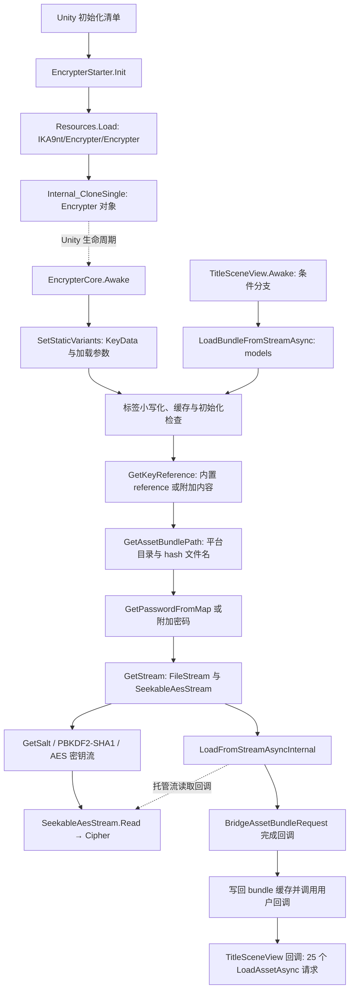

# Windows 资源包加载 → 解密 → Unity 加载调用链

目标仍是 `E:\SecretFlasherManakaREA\GameAssembly.dll`，SHA-256 `6003033049ac32e8712dc4101382534e21d65b97100c167ebec6bbca1462c18d`。本轮新增 54 个 REA/Ghidra 原生观察：51 个元数据方法、3 个没有唯一元数据方法坐标的原生跳板。四个批次均成功导出证据并关闭会话，未运行游戏。

机器可复查的索引为 [`salt/evidence/loading-chain.json`](salt/evidence/loading-chain.json)，包括全部新 Evidence ID、120 个字符串/方法/类型 usage 绑定、25 个标题场景资源请求和 20 条选定的伪代码调用边。包装器声明、初始化清单和原始预制体证据在 [`salt/symbols/loading-declarations.json`](salt/symbols/loading-declarations.json)。这不是全游戏调用图。

## 当前构建的主路径



实线表示本轮静态调用/数据证据支持的关系；虚线表示 Unity 生命周期或引擎与托管流的接口边界，未观察运行时事件。`UnityPlayer.dll` 内部调度不属于本次 `GameAssembly.dll` 反编译范围。

## 初始化与 KeyData 的原始引用

- `RuntimeInitializeOnLoads.json` 注册 `EncrypterCore.StaticReset` 为 `SubsystemRegistration`，`EncrypterStarter.Init` 为 `BeforeSceneLoad`。它证明注册关系，不证明某次运行已执行。
- `EncrypterStarter.Init` 原生入口 `0x1814404f0` 引用字符串 `IKA9nt/Encrypter/Encrypter`，调用 `0x1809fce30`，再调用 `0x1809f0e30`，最后设置对象名 `Encrypter`。
- 对两个泛型跳板进一步反编译：前者显示 `UnityEngine.Resources.Load`，后者解析并调用 `UnityEngine.Object::Internal_CloneSingle(UnityEngine.Object)`。泛型运行时实例的完整类型参数仍未重建。
- 原始 UnityFS 的 `globalgamemanagers` / ResourceManager pathID **13** 有容器项 `ika9nt/encrypter/encrypter`，PPtr `(fileID=3,pathID=3629)`；external 3 明确指向 `resources.assets`。
- GameObject **3629** 名为 `Encrypter`，组件数组包含 EncrypterCore **63738**。组件中的 KeyData PPtr `(0,61594)` 正好指向前次恢复 GUID、`models` 映射和 salt 的 **61594** 对象。该组件序列化参数是 `loadBufferSize=256`、`loadSpeedOnMemoryLoadAsync=0`。
- Core `Awake` 做重复实例检查，保留有效对象，调用 `DontDestroyOnLoad`，把 KeyData 和两个参数交给 `SetStaticVariants`，然后调用初始化后委托。`ErrorCheck01` 也会调用无参 `SetStaticVariants` 作惰性补齐。
- `EncrypterKeyData.OnAfterDeserialize` 从 `_keys` / `_values` 重建运行时 `reference` 字典，并从 `allBundleList_Key` 建立另一个字典。不能把磁盘中没有字典 payload 误判为运行时字典为空。

原始资源字段位置是序列化对象中的偏移，不是 IL2CPP 实例字段偏移。`loading_evidence.py` 会重新读取原始资源字节、校验对象 SHA-256，并验证上述 PPtr 和两个参数。

## 标题场景是真实业务入口

`ExposureUnnoticed2.Scripts.UI.TitleSceneView.Awake` 的 metadata ID **16362**、原始 token `0x060013a1`、VA **`0x18046e4e0`**。REA 伪代码在条件分支显示：

```text
LoadBundleFromStreamAsync("models", <Awake>b__30_0, "", 0)
```

原始 DLL 的 `0x18046f08e` 有对应的 `E8 rel32` 字节，目标是 **`0x181436710`**。此前扫描得到的 `0x18046e637` 是该方法内部的 unwind 子区域起点，不是另一个元数据方法入口。

回调目标不是按名称猜测：usage `0x182d5bf88` 的原始编码是 `0x60007ff1`，按 method-definition usage 解码为 ID **16376**，即 `<Awake>b__30_0` / VA **`0x180470260`**。回调伪代码中有 **25** 次 `EncrypterCore.LoadAssetAsync`，每次标签都是 `models`；原始相对调用字节也对应 25 个位置。资源名称从每次调用绑定的 metadata literal 恢复，完整清单保存在 `loading-chain.json`，包括 `Player`、`MHair`、`MCustomizeColor` 等。

这条路径受 `SystemManager` 静态布尔位条件控制；其 `.cctor` 把对应 `+2` 位设为 `1`。类型 usage、字段声明顺序支持它与 `IsEnc` 的关联，但完整运行时字段布局及后续是否被修改尚未观测，不把默认值描述为所有运行都必然进入此分支。

## 标签、文件名与密码如何进入流

| 阶段 | 原生实现与行为 |
| --- | --- |
| 标签 | `LoadBundleFromStream` / `Async` 对标签调用 `ToLower`。`models` 不发生变化。 |
| 缓存 | `ErrorCheck03` 检查标签是否已存在于 bundle 缓存；已存在时记录消息并提前返回。资源请求还检查包是否已登记及请求状态。 |
| 初始化/标签有效性 | `ErrorCheck01` 补齐静态数据并验证标签可从内部或附加映射找到；`GetKeyReference` 返回 reference 和是否来自附加内容的标记。 |
| KeyData | 内置标签从 `KeyData.reference` 取 `assetPath` / signed int64 `hash`。附加内容分支会另建 reference 并移除路径中的 CR；本轮未验证实际 DLC。 |
| 目录 | `GetBasePath` 调用 `Application.get_streamingAssetsPath`。`GetPlatformPath` 支持自定义路径；Windows 分支先检查 `StandaloneWindows64` 目录。 |
| 文件名 | `GetAssetBundlePath` 查看 KeyData 的 `fileName`。本构建值 **0**，因此使用 `hash.ToString()`，即 `-265379604`。 |
| Windows 文件回退 | 加载入口的 `File.Exists` 失败时还调用 `GetAssetBundlePathWinx86`；该辅助函数使用 `GetWindowsx86Path` / `StandaloneWindows`。其他平台及目录不存在时的完整回退组合未穷尽验证。 |
| 密码 | 内置映射调用 `GetPasswordFromMap`；附加分支取其附加数据密码并检查。标题入口传入空密码，内置 `models` 路径会从已验证的字符池映射恢复它。 |
| 文件与盐 | `GetStream` 打开 FileStream（Open / Read / Share.Read），调用 `GetSalt(label)`，创建 `SeekableAesStream`，参数为 keySize **256**、ECB **2**、None **1**。 |

本构建完整密文路径因此为 `SecretFlasherManaka_Data/StreamingAssets/StandaloneWindows64/-265379604`。AES 自定义小端计数布局、密码派生和全部 3,819 个块的独立解密验证沿用已有证据，见主 README；本轮没有更换密钥或加密算法。

## 流加载、内存加载与异步完成

| 入口 | 解密与 Unity 接口 | 完成/缓存 |
| --- | --- | --- |
| Stream 同步 `0x181436120` | `GetStream` → `ValidateLoadFromStream` → `LoadFromStreamInternal(stream, crc=0, buffer)` | 实际分配的 `BridgeAssetBundle` 与解密流保存在 `CacheData` 中；旧伪代码的 EncryptLabelData 构造函数名是共享地址种子别名。 |
| Stream 异步 `0x181436710` | `GetStream` → `ValidateLoadFromStream` → `LoadFromStreamAsyncInternal(stream, crc=0, buffer)` | `BridgeAssetBundleRequest` 转接 Unity 完成事件；内部回调写缓存，后一个回调调用用户 Action。 |
| Memory 同步 `0x181437050` | 按文件长度分配 byte[]，从 `GetStream` 得到的流做一次虚拟 `Read`，然后 `LoadFromMemory_Internal(bytes, crc=0)` | 释放读取流；缓存加载后的标签数据。伪代码未显示循环补读，不能宣称所有流实现都自动读满。 |
| Memory 异步 `0x181437740` | 直接创建 FileStream、`GetSalt` 与相同的 `SeekableAesStream`，然后创建模式 2 请求 | 状态机通过 `Task.Run` 发起读取，循环 Read / Copy 到 byte[]；解密结束触发 `completed2`，由回调调用 `LoadFromMemory_Internal` 并写缓存，再调用用户完成 Action。 |

两条异步机制不同：流异步主要转接 Unity 的异步包加载；内存异步中的 `Task.Run` 先异步读取/解密，其完成回调调用的是 **同步** `LoadFromMemory_Internal`。不能仅凭外层 API 名称把两者视为同一工作方式。

`BridgeAssetBundleRequest::<.ctor>b__32_0` 明确从 `AssetBundleCreateRequest.get_assetBundle()` 取结果，再调用插件的 `completed` 委托。`<LoadBundleFromStreamAsync>b__0` 写回缓存，`b__1` 调用传入的用户回调。相应方法 usage 原始编码、目标 ID 和 VA 已保存在机器索引中。

缓冲值必须区分单位和调用位置：预制体保存 **256**；内存异步读取代码把它左移 10 位作为分块字节数。标题场景传给流异步入口的是 **0**，实际 Unity Internal 调用同样传 **0**。不要把前者解释成标题场景固定向 Unity 传 256 字节，也不要把 Unity 参数 0 解释为引擎完全不使用缓冲。包装器的省略参数重载也会转发 0。

资源请求最终经过 `EncrypterBundle` 接口分派；`0x18001f490` 是查找接口槽并间接调用的跳板。后续已通过 TypeInfo、原始 vtable 和针对性 REA 分析，确定本路径接收类型为 `BridgeAssetBundle`、接口槽 2 对应其 `LoadAssetAsync`，并继续追踪了对象获取、25 个回调和实例化/缓存消费者。见 [资源请求后续链](asset-followup.md)。原始观察与旧种子标签不改写，以保留证据身份。

## 核心证据坐标

| 证据 | 文件 / Evidence ID |
| --- | --- |
| 标题入口 → 包加载 | `loading-game/16362-060013a1-procedure_pseudo_code.json`；`ev_1c7ec785952a76f83162d704eb2aaa7afbb70387dbd084db1c66116d526470a9` |
| 标题完成后的 25 个请求 | `loading-game/16376-060013af-procedure_pseudo_code.json`；`ev_56945232904276ecc769fb27df40ca32f9de8bcd0f5bdc0d589280c8a71341eb` |
| 异步流 → 解密流 → Unity | `loading/76290-06000079-procedure_pseudo_code.json`；`ev_3f773530765ae9b3092d06ed847867e78b27df703794c383294c2069a776389f` |
| 同步流 → 解密流 → Unity | `loading/76288-06000077-procedure_pseudo_code.json`；`ev_a7d0309c53f7f8036f2e2e37edfdc4ab8dd6134038ac0ae00dd690354d8a7474` |
| 内存异步直接创建 AES 流 | `loading/76294-0600007d-procedure_pseudo_code.json`；`ev_3699173373e6e9fe0fb80da58f091ef44a20b84ee4945a0de96b8ac5acead457` |
| KeyData 反序列化 | `loading/76199-0600001e-procedure_pseudo_code.json`；`ev_0c1967e14de53072bdf650c36be275f01ece07b421fc664b854ad6bd77cb97c3` |
| Resources 泛型跳板 | `loading-thunks/native-0x1809fce30-procedure_pseudo_code.json`；`ev_8dfef42f980bce73fef94e7a020cd5de11601e18d17cdd956df7a049016c7b01` |
| 克隆泛型跳板 | `loading-thunks/native-0x1809f0e30-procedure_pseudo_code.json`；`ev_a53521b50518911c4a24fc82936727a1fb7408a4c7db258054455957dc9de557` |

表中文件均相对 `salt/evidence/`。所有 54 份原生记录的完整路径和 ID，以及四个批次证据包，均可从 `loading-chain.json` 或目录 `run.json` 查询。

## 复现与剩余边界

在仓库根目录，沿用既有 REA、Ghidra、JDK、Python 环境：

```powershell
# 若换机器或缓存缺失，先重建方法坐标
python reverse-engineering/salt/metadata.py index
python reverse-engineering/salt/prepare_loading.py
node reverse-engineering/salt/run_batch.mjs reverse-engineering/salt/symbols/loading.plan.json

# 其余三批直接使用已保存计划；输入/种子 SHA-256 必须一致
node reverse-engineering/salt/run_batch.mjs reverse-engineering/salt/symbols/loading-game.plan.json
node reverse-engineering/salt/run_batch.mjs reverse-engineering/salt/symbols/loading-guards.plan.json
node reverse-engineering/salt/run_batch.mjs reverse-engineering/salt/symbols/loading-thunks.plan.json

# 重新读取原始 usage、调用字节和预制体，核对已保存绑定
python reverse-engineering/salt/loading_evidence.py --check
python reverse-engineering/audit.py --inputs
```

计划保存本机绝对路径。迁移机器时用 `prepare_loading.py --name ... --method-id ...` 或 `--native-va ...` 重新生成对应计划；ID/VA 从保存计划读取，只适用于已固定 SHA-256 的构建。重新运行 REA 会产生新的观察身份，需审阅后重建 `loading-chain.json` 和总指纹索引，不能期待新会话与旧 Evidence ID 相同。

已回答：原始初始化资源、KeyData 引用、标题业务入口、内部/附加映射分支、文件名和平台路径主分支、密码进入解密流、同步/异步流和内存接口、包完成后的缓存与用户回调。部分回答：泛型具体实例类型、接口接收者、少数 Ghidra 恢复警告。未验证：实际线程调度/时序、全部平台与 DLC、运行时 patch 或模组修改，以及 UnityPlayer 引擎内部。所有结论为静态观察或明确标出的推断。
