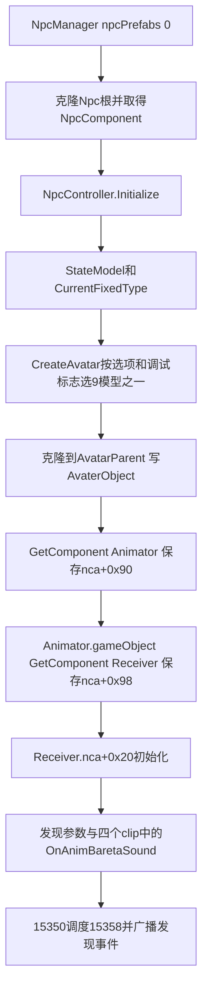

# NPC 模型选择、接收器来源与控制器初始化

后续补充：[NPC调帧与事件时序](npc-fps-chain.md) 已用原始指令补齐手动Update浮点实参，并连接上层隐藏调用门、IsTimeStop速度处理与通知计时挂起；下文浮点实参未恢复描述保留为上一阶段边界。

当前 NPC 工厂的接线缺口已能用资源与原生代码共同解释：`Casual1` 虽有 Npc AnimatorController，却不在该工厂配置的候选模型中。实际候选9个模型都在 Animator 同物体预先挂载 `NpcAnimationEventReceiver`；模型克隆后通过 GetComponent 取得该接收器，再写入 nca。所检查路径没有通过 AddComponent 修补 Casual1 接收器，也没有替换 RuntimeAnimatorController 的观察。

这是选定工厂/初始化路径的静态结论，不是“Casual1 永远不会被任何代码使用”或“整个进程没有动态添加/覆盖”的全局证明。原始输入仍为 `E:\SecretFlasherManakaREA`，没有运行游戏或改动原始资源。

## 1. 从工厂 prefab 到九个模型

资源来源与字段跨度见 `assets/npc-model-wiring.json`。原始资源不带 type tree 的组件，按原始 IL2CPP 字段声明、已有只读 interop 声明与实际字节布局交叉核对；字段偏移、PPtr与原生对象偏移是不同坐标，分别保留。未从 interop 缺失自定义属性推断原始 Unity SerializeField 属性。

`resources.assets` 的 NpcManager79105（72B）保存 npcPrefabs 数组，count=1，唯一条目为 GameObject14572=`Npc`。该根的 NpcComponent64590（236B）包含：

| NpcComponent字段 | 原生对象偏移 | 模型GameObject pathID |
| --- | --- | --- |
| PrefabFemale | +0x30 | 18578 |
| PrefabMale | +0x38 | 8129 |
| PrefabPreviousFemale | +0x40 | 9079 |
| PrefabPreviousMale | +0x48 | 15957 |
| PrefabOjis | +0x50 | 数组6049、15608、22017 |
| PrefabObas | +0x58 | 数组15087、16591 |
| AvatarParent | +0x78 | Transform22455 |

这9个模型的 Animator 均指向 `resources.assets` Controller1995=`Npc`，同物体均有 NpcAnimationEventReceiver 和 NpcAvatarComponent。Casual1 根17757、Animator26485和 AvatarComponent72409不在以上字段/数组中。它自身未序列化接收器的事实仍成立；先前把它列为“十个直接引用Npc控制器的Animator之一”并不表示工厂会选择它。

`NpcManager.InstantiateNpc`（15587，0x18042fe70）读取 npcPrefabs **索引0**，以 manager.transform 为 parent 克隆，再 GetComponent<NpcComponent>。它创建普通 NpcController 对象，保存到 component.`+0x98`，然后调用 Initialize、登记 ExistNpcList 和对象字典。`CreateFixedNpc`（15588）也调用同一 InstantiateNpc，再 AdditionalInitializeForFixAction；它没有独立选择 Casual1 的分支。

`NpcComponent.CreateController`（15450）同样是分配普通 NpcController 并保存业务字段，不是创建或替换 Unity AnimatorController。

## 2. Avatar选择的真实分支

`NpcController.Initialize`（15518，复用）先建立 StateModel，并写 CurrentFixedType；之后建立 NpcComponentAccessor（15488，复用）。Accessor构造调用 `NpcAvatarSelector.CreateAvatar`（15434，0x1804227a0），选择并克隆模型，再继续查询模型组件。

CreateAvatar读取 `GameState.OptionData`：MaleRate100原生偏移`+0x14`、OldPeopleRate100=`+0x18`；读取 StateModel.CurrentFixedType=`+0x58`。以下是对保存伪代码的等价条件摘录，不代表运行时选项值：

1. 第一次 Random.value 为 r1，计算 `femaleCandidate = (MaleRate100 * 0.01 <= r1)`；DebugController.IsOnlyYoungWomen（静态`+0xd`）会强制女性分支。该结果写 StateModel.isFemale。
2. 第二次 Random.value 为 r2。若非 IsOnlyYoungWomen、FixedType!=10、且 `r2 <= OldPeopleRate100 * 0.01`，进入老人分支：女性从 PrefabObas、男性从 PrefabOjis 取随机项，分别写 AvatarType=3/2。
3. 其余男性分支再次取 r3；FixedType!=10且r3>=0.5时取 PrefabPreviousMale（AvatarType=5），否则 PrefabMale（1）。
4. 其余女性分支再次取 r3；FixedType!=10且r3>=0.6时取 PrefabPreviousFemale（4），否则 PrefabFemale（0）。DebugController.IsOnlyPreviousWomen（静态`+0xf`）还可强制这一女性分支取旧女性模型；不能把“FixedType10禁旧模型”说成覆盖了调试强制条件。

所有成功分支均把候选 prefab 克隆到 AvatarParent，再调用 set_AvaterObject（15447）写 NpcComponent.`+0x90`，之后写 AvatarType。setter本体只有字段赋值/GC写屏障，没有添加组件、加载新资源或切换控制器。阈值边界保留原生比较方向；不把它们改写成精确概率保证。

GetRandom 的 MethodSpec 原始参数为 GameObject，保存在 native usages 中；其选取辅助函数也保存原生观察。AvatarType枚举的名称/数值、字节来源在资源JSON中保留。

## 3. 克隆后的接收器与发现事件



15488中的两次泛型调用分别经原始 MethodSpec 绑定到 `GetComponent<Animator>`（usage `0x182d58250`）与 `GetComponent<NpcAnimationEventReceiver>`（`0x182d59a70`），不是 AddComponent。15518在 receiver存在的守卫后写 receiver.`+0x20`=nca。15359则从 nca.`+0x90`取得 Animator，15403延迟回调执行 Rebind(true) 并写 IsFemale 参数。

因此选定路径中 Receiver 来自候选模型 prefab 的组件克隆，之后才获得所属NPC引用；不需要假设 Casual1 在运行时被补接收器。发现控制器参数、四种clip、事件时刻和15350→15358延迟广播沿用 [动画接线报告](animator-wiring.md)。仍要满足该报告列出的发现守卫和事件实际播放条件。

AvatarComponent.Initialize（15425）及 NewYoung（15427）、NewOld（15428）、Previous（15429）处理外形、renderer、材质、显隐与手持物父节点等。Initialize对AvatarType2/3内联了NewOld相同的renderer获取逻辑，不能把独立函数15428的存在当成该处直接调用。选定初始化子分支没有显示切换Animator.runtimeAnimatorController。

Initialize安排的一帧延迟回调15433也已补查：遍历 previousMaleBodyRenderers，读取renderer材料并保存到 previousMaleMaterialDict，没有在此处添加接收器或设置控制器。随机辅助函数0x180005530调用 RandomRangeInt(0,array.length)后返回数组项，空数组返回0；没有额外加载Casual1的分支。

## 4. 运行组件添加、控制器替换与播放边界

`salt/evidence/npc-model-chain.json` 保存各选定函数的 ICall/泛型 usage 目录，以及全部113,283条注册 MethodSpec 中 AddComponent 两个定义（49150/49151）的条目。没有具体 `NpcAnimationEventReceiver` 的 AddComponent 泛型实例；其中泛型变量、System.Object等不能静态穷举实际类型，非泛型 AddComponent(Type)、反射及外部Mod也不由此排除。

同时按ASCII前缀搜索整个已固定指纹的原生文件：标准 `UnityEngine.Animator::set_runtimeAnimatorController` 未命中；`set_avatar` 和 `Internal_AddComponentWithType` 有命中并保留坐标。这说明应将“所查NPC路径未见控制器替换”与“文件中存在其他添加组件/Avatar操作能力”区分开。字符串有无不是全局调用图证明，也没有凭名字相似把 Avatar 赋值与 AnimatorController 替换合并。

Casual1的有界PPtr形状字节搜索还命中 ResourceManager/ES3ReferenceMgr缓存和自身组件owner字段，均未冒充实际模型选择入口。models中32,814个GameObject名称未出现Casual1；4,053个MonoBehaviour的m_Script指针也未解析到所选NPC脚本类，其中2,544个为空脚本指针，不能替这些对象补上未知身份或排除运行构建组件。

NpcAnimatorFpsController.Initialize（15404）持有已选模型Animator；OnUpdate（15405）在近处恢复 Animator.enabled，较远时关闭自动更新并累计 deltaTime、按阈值手动 Animator.Update。它改变的是更新方式，不是控制器引用。Ghidra对该 ICall 的浮点实参未完整显示，本轮不报告精确播放步长、事件补发/遗漏或墙钟触发时间。不能从 enabled=false 单独推断“发现事件永远不会触发”。

## 5. 证据与未知项

原生查询计划、种子、逐函数完整JSON/伪代码和REA导出位于 salt/symbols/npc-model-* 与 salt/evidence/npc-model-*；汇总为 `salt/evidence/npc-model-chain.json`，原始构建指纹与前轮一致。原始资源证据为 `assets/npc-model-wiring.json`。运行复核：

新增14次非空REA查询：selection 5、initialize 7、tail 2，全部正常结束并关闭。复用前轮的Accessor、控制器初始化及发现事件观察。关键证据：

| 结论 | 方法 / Evidence ID |
| --- | --- |
| 九候选模型的原生选择 | 15434 / `ev_48ac7cea56cac4ce074c4ef9362e404721cd1bcd9eb99cdd85696665da3b8fb0` |
| 工厂只克隆npcPrefabs[0] | 15587 / `ev_cbecc1dd855b03d0b6c384903c214538eb25b167605e99b909ab3e52b958f79b` |
| CreateController是普通业务对象分配 | 15450 / `ev_6c2f99bb7ebd72324a0d2591dc4c8c23120100921c8c1abca4f5e165839ed53b` |
| AvaterObject字段赋值 | 15447 / `ev_75126521564cd7c974923a14fe094c83a1ca03707e360f388e78730b3144f038` |
| 延迟初始化不补接收器 | 15433 / `ev_1309f52bebce0bcf98a15d2384c51b174f7de5b08ddeaf04e3559321fa24058a` |
| 数组随机选取辅助 | 0x180005530 / `ev_7b70115316cad33fc4e07a3ad8f540b4b1a1d30b6068fd31af1cae7831d6c5bc` |
| 调帧与Animator启停 | 15405 / `ev_97a5f467b5fe41a31191d90cc914342b543f98113597314c4fbdf3be62aa482e` |

```powershell
python reverse-engineering/assets/inspect_npc_models.py --check
python reverse-engineering/salt/npc_model_evidence.py --check
python reverse-engineering/audit.py --inputs
```

已回答：当前NPC prefab入口、九候选模型分支、Receiver来源与nca接线、CreateController语义，以及选定初始化未见添加Receiver/替换RuntimeAnimatorController。部分回答：Casual1在本工厂范围被排除，其全部潜在消费者仍未知；延迟/调帧与实际回调尚无运行证据。没有据此生成可运行重建或修改游戏逻辑。
