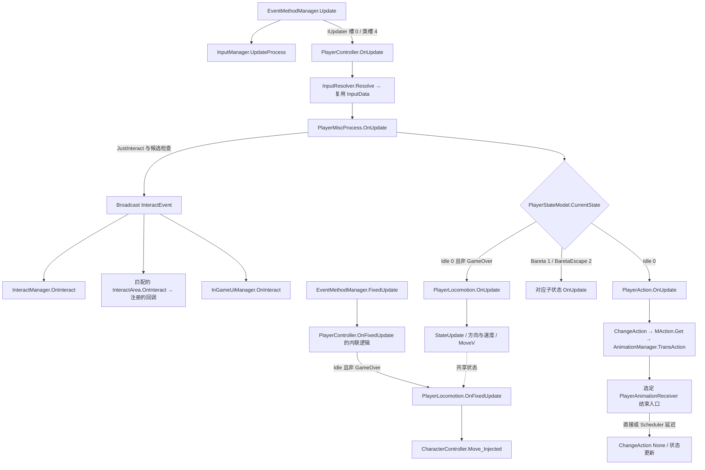

# 玩家输入、移动与操作调用链

本轮把 `PlayerController` 连接到输入解析、移动计算、Unity 物理位移、交互事件和选定动画结束回调。固定原始目录仍为 `E:\SecretFlasherManakaREA`；使用 REA 6.5.0 / Ghidra 12.1.4 完成 6 批、94 次非空原生函数查询，覆盖 94 个地址，并复用上一轮 6 个初始化/帧入口观察。会话均已关闭。本报告是静态重建依据，未执行游戏、验证手感或产出可独立运行的实现。

机器证据在 [player-chain.json](salt/evidence/player-chain.json)，包括原始 metadata 方法记录、参数、共享地址别名、字段注册表坐标、306 个 metadata usage 绑定、接口分派和伪代码引用。配置证据在 [player-config.json](assets/player-config.json)，原始字节、对象位置、压缩块来源和解析边界均保留。下文的方法 ID 是当前构建 metadata 全局索引，不是跨版本标识。

## 主要调用关系



图中分支是控制流摘要，不代表广播监听器实际执行顺序，也不是每个动作都经过同一种动画完成入口。`PlayerMiscProcess` 的交互检查早于普通移动/动作分支，不能把所有交互都放在移动之后。

## 1. 玩家对象与帧入口

上一轮的 `PlayerController.Initialize`（14756）与本轮 `PlayerClassAccessor` 构造/初始化（14714/14715）连接以下运行时对象。`PlayerLocomotion` 是创建出来的普通类，不能当作 prefab 上序列化的 MonoBehaviour。

| 所属对象 | 原生字段偏移 | 对象/意义 |
| --- | --- | --- |
| PlayerController | `+0x38` / `+0x40` | InputResolver / PlayerClassAccessor |
| PlayerClassAccessor | `+0x30` | CharacterController |
| PlayerClassAccessor | `+0x48` / `+0x58` / `+0x60` / `+0x68` | AnimationManager / Locomotion / StateModel / PlayerAction |
| PlayerClassAccessor | `+0x78` / `+0xd0` / `+0xd8` | ObjectReferencer / StaminaManager / NavMeshAgent |
| PlayerClassAccessor | `+0x160` / `+0x168` / `+0x1f8` | MiscProcess / AnimationReceiver / MoveCalculator |

`EventMethodManager.Update`（16737）先更新输入管理，再通过已验证的 IUpdater 分派进入 `PlayerController.OnUpdate`（14757，`0x180643a10`）。FixedUpdate（16736）中可见控制器固定更新的内联路径；单独查询 14758 与其守卫一致。输入解析发生在状态分支前，控制器随后更新体力、其他身体状态和 MiscProcess。

原始 metadata 压缩默认值及 interop 声明逐项一致：`PlayerState` 是 `Idle=0, Bareta=1, BaretaEscape=2`。普通移动只在 Idle 且非 GameOver 时处理；PlayerAction 的 Idle 分支并不与移动共用完全相同的 GameOver 守卫。`ChangeState`（14759）进入/离开 Bareta 时还处理动画、当前动作、LookAt 和 NavMeshAgent；这两个特殊子状态的内部规则仍未完整恢复。

控制器已观察到的尾部清理会将 `TransPick/TransPickClothes` 清零、`TransAction` 设回 -1，调用 `PlayerAction.OnFrameEnd` 解开本帧切换锁并扣除姿势冷却。它发生在控制器更新尾部；InputManager 自身的 LateUpdate（17227）另行清除“本帧已更新”标志，两者不能混为一处。

## 2. 输入来源与解析

原始 `resources.assets` pathID **61593** 是实际 `PlayerAction` InputActionAsset，15,304 字节完整解析至 EOF：1 个 Player map、61 个 action、88 个 binding、2 个 control scheme。PlayerInput 的 `m_Actions` 引用指向它，默认 map 是 Player。另一个 `DefaultInputActions` 示例资源不是游戏输入表。

`InputManager.Awake`（17221）用 `Enum.GetValues(InputType)` 建立数值到名称的表。`GetInputAction`（17236）通过当前 PlayerInput 的 action map 按名称取 InputAction；其索引器为 `InputActionMap.get_Item`（27063）。58 个枚举项包含 None，数值在 34 后跳到 1000，绝不可用 action 数组下标代替枚举数值。资源表额外含 CloseClothesB、TakeOffBra、TakeOffPants、TestSwitchVibrator 四个名称；名称存在本身不证明这些额外项可由通用枚举读取路径触发。

| 默认操作 | InputType | 键鼠 / 手柄原始绑定 | 解析后的主要结果 |
| --- | ---: | --- | --- |
| 移动 | 0 | WASD / leftStick | Move → x/z 平面向量 |
| 镜头 | 1 | mouse delta / rightStick | CameraMove |
| 跑步 | 3 | LeftShift / buttonSouth | Dash，持续读取 |
| 视角切换 | 4 | R / leftShoulder | JustViewChange，按下帧 |
| 蹲下 | 7 | C / buttonWest | JustCrouch，按下帧 |
| 交互 | 8 | F / buttonNorth | JustInteract + Interact，按下与持续分别读取 |
| 取消 | 10 | Escape / buttonEast | JustCancel |
| 通用轮盘 | 14 | 1 / dpad up | HoldCommonRingMenu，GetLongDown(...,10) |
| 技能轮盘 | 23 | 2 / dpad left | HoldSkillRingMenu，GetLongDown(...,10) |
| 单手向前移动 | 33 | O | MoveForwardOneHand |

这张表是原始默认配置，未观察玩家保存的重绑定。手柄两根摇杆的原始 processor 为 StickDeadzone。InputManager 的 `IsDown`（17233）对应 InputAction.IsPressed（26950）；`IsDownFrame`（17231）对应 WasPressedThisFrame（26953）；`IsUpFrame`（17232）对应 WasReleasedThisFrame（26955）。

`GetVector3(0)`（17228）读取二维 Move 并重排为 `(x,0,y)`，返回向量所用的原生隐藏输出参数不是 C# 的额外业务参数。镜头 `GetVector2`（17229）在其中一个设备分支还对分量作带符号平方，不能把两个设备分支都简化为未经处理的原始向量。

`InputResolver.Resolve`（14421，`0x180620800`）复用 InputData，重置选定字段，受 UI/GameOver/表演状态守卫控制。Move 模长平方达到 0.5 时归一化，小输入保留模拟量；它不是所有非零输入均归一化。解析还使用 PadShift、轮盘快捷设置等条件覆盖部分按钮含义。机器文件保留 22 次直接布尔赋值的字段 ID、原生偏移、数值/名称、读取器及原始源码摘录；这是条件分支内的赋值集合，不是脱离上下文的完整键位规格。

`UpdateProcess`（17225）维护按住计数及平均帧时间。`GetLongDown`（17234）的门槛结合选项值、请求计数和平均 deltaTime；`10` 不能直接解释成 10 秒或固定 10 个渲染帧。

**跳跃边界：** Locomotion 存在读取 `InputData.Jump(+0x24)` 的分支，但本次保存的 Resolve 对该确切字段只发现一次写零；真实游戏输入 asset 和 InputType 枚举均没有 Jump。Space 实际默认绑定 CloseClothesA。不能据此宣称已恢复可操作的跳跃，也不能把限定字段搜索扩展成全原生代码没有其他写入的证明。

## 3. 移动状态、速度与物理出口

`PlayerLocomotion.Initialize`（14894）连接角色控制器、相机、动画、状态、NavAgent 和碰撞校正器，并关闭 NavAgent 自动更新位置/朝向。`StateUpdate`（14901）处理 Dash、蹲姿、AutoChase/AutoRun：跑步需要输入和移动意图，同时受当前动作、特殊状态、跑步按钮锁等约束；蹲姿还检查约束/交互条件。自动追踪和自动前进互斥，手动开始移动、Dash、再次切换或 JustInteract 可进入取消路径，追踪取消还关闭 NavAgent 并清空目标引用。

`OnUpdate`（14899）先进行 StateUpdate，再处理自动方向、相机相对移动、横移与旋转、速度平滑及动画参数，将移动结果交给共享状态。当前动作 `CanMove=false`、IsEcstasyMotion 或 InvalidLocomotionTime 尚未到期会把移动目标速度清零；这不等价于不再执行后续垂直/固定位置处理。`MActionRecord.get_CanMove`（16342）只是读取 `+0x1c` 的字节。

原始 `MCommon` pathID **61717** 的已解码前缀与注册字段偏移相连：

| 字段 | 原生偏移 | 对象序列化偏移 | 保存值 |
| --- | --- | ---: | ---: |
| playerCrouchSpeed | `+0x54` | 100 | 0.6 |
| playerWalkSpeed | `+0x58` | 104 | 1.1 |
| PlayerGamanWalkSpeed | `+0x5c` | 108 | 0.63 |
| playerJogSpeed | `+0x60` | 112 | 2.4 |
| playerMaxStamina | `+0x64` | 116 | 1.0 |
| playerStaminaRegeneration | `+0x68` | 120 | 0.3 |
| playerStaminaRegenerateSecond | `+0x6c` | 124 | 1.0 |
| PlayerStaminaDashPerSecond | `+0x70` | 128 | 0.2 |

这些是存储的基础参数，实际速度还乘以输入强度、选项/技能和动作参数，并经过平滑；不能直接当作始终不变的世界速度。跑步分支调用 ConsumePerSecond（15000），消耗还有游戏状态修正；Stamina.OnUpdate（15001）负责恢复路径。完整浮点位模式在配置 JSON 中，表中使用简短十进制。

构造函数（14906）将 skipGravityCount 置 10、gravity 置 1.0，未在该构造体写入 jumpPower。OnUpdate 根据接地检测更新 verticalPower，已见减 gravity 的操作本身没有乘 deltaTime，不能套用常见的 `9.81*dt` 重写。垂直积分、地面探测和引擎步长对实际轨迹的影响尚无运行验证。

`OnFixedUpdate`（14900，`0x180653b00`）处理平滑目标/固定位置与旋转/传送标志，以移动向量、`SumFixedPushVThisFrame`、fixedDeltaTime 和校正量组成位移，在非零分支调用 `UnityEngine.CharacterController::Move_Injected`，随后清理累计固定推力。另有设置 Transform 的固定位置和 warp 路径；并非所有位移都只来自 WASD 或 Move。

Player prefab 的真实 CharacterController 完整结构解析得出：height=1.6、radius=0.2、slopeLimit=45、stepOffset=0.2、skinWidth=0.0001、minMoveDistance=0.001、center=(0,0.8,0)。碰撞校正（15107）对胶囊/角色的接近情况调用 Physics.Query_ComputePenetration_Injected 并修正 Transform；MoveCalculator（15118）另行跟踪实际移动。UnityPlayer 内部物理求解并未从 GameAssembly 中重建。

## 4. 交互候选、事件与动作状态机

候选机制由 InteractManager 和 InteractArea 协作，不是基于“最近距离”排序的通用选择器：

1. InteractManager 的静态构造（17381）创建列表并放入 `Type=None(0)` 的哨兵。GetHead（17375）取列表末项；这个初始哨兵解释了没有普通候选时的路径，但不证明任意修改列表后仍不会为空。
2. InteractArea.OnTriggerEnter（15820）确认碰到玩家根对象后注册 `(InteractType, controller)`；Register（17376）追加到列表，故最后注册的有效候选位于末尾。Exit、Disable、Dispose 负责注销（15821/15822/15819、17377）。
3. MiscProcess.OnUpdate（14908）在 JustInteract 时读取末项，跳过 None，并检查 IsEcstasyMotion。当前动作非 None 时还要求候选控制器允许 `CanInteractWithAction`，随后把候选写入 InteractEvent.Model 并 Broadcast。
4. InteractManager.OnInteract（17379）保存 CurrentInteractModel。Area.OnInteract（15823）只响应 Model.Controller 等于自身的事件；手持衣物时一般拒绝，`WasherMachine(9)` 是此处分支的例外。符合条件后调用已注册 Action，标记 isInteracting，关闭提示效果。UI 的 OnInteract（15848）也接收此事件并按交互类型处理界面。
5. 实际操作可经 PlayerFacade.TransAction（14811）写入 State.TransAction，PlayerAction.OnUpdate（14462）消费输入/外部请求；ChangeAction（14463）受本帧切换锁守卫，切回 None(-1) 的分支调用 Locomotion.OnEndAction，后续保存 LastInteractModel、取得 MActionRecord、写入 CurrentAction，再调用 AnimationManager.TransAction（14536）。不是每一个 Area 的回调都已被证明一定走 TransAction，UI 分支也可能只打开界面。

`MAction` pathID **61645** 的 78 个记录 PPtr 完整读至 EOF。每个记录只解码 Type、canMove、CantCancelDash、IsMoveOnlyForwardWithStrafe、IsMoveToCancel、HandcuffsWeight 前缀，其余原始尾部明确保留未知。例如 None=-1 的 canMove=true；50000 的记录也允许移动且设置 onlyForward，说明“正在动作”与“禁止移动”是不同判断。MAction 表内的 PPtr 偏移属于父表对象，记录字段偏移属于各自目标对象；两套坐标不能混用。

选定结束路径已经继续到业务状态提交，而不是停在 Animator 调用：

| 原生入口 | 后续状态/业务效果 | 边界 |
| --- | --- | --- |
| OnAnimEndPick（14488） | 处理拾取/持有分支；可见内联 ChangeAction(None) 逻辑、LastInteractModel、MAction.Get(-1) 与动画切回 | 保留本帧切换锁等守卫 |
| OnAnimEndPickUpItem（14489） | DroppedItemManager.Collect / 物品数量更新后进入回空动作逻辑 | 具体物品类型由分支决定 |
| CommonOnEndAnim（14494） | 提交类型特有结果，创建延迟模型，计数置 2，交给 Scheduler | 不是立即无条件清空动作 |
| `<CommonOnEndAnim>b__22_0`（14513） | ChangeAction(-1)，再处理待扣除物品/次数引用 | Scheduler 实际执行时刻未观测 |
| OnEndSitDown（14509） | 创建计数为 4 的延迟模型 | 回调 14514 将 IsSit(+0x23a) 置 true |
| EndArmAction（14497） | 清除 IsArmAction(+0x18) | 手臂动作标志与整体 CurrentAction 分开 |

Scheduler.Update（17304）可见帧延迟列表迁移与 CountdownAndInvokeIfNeed 调用。这里的 2/4 是保存的计数参数；与 Unity 各 Update 的真实先后、动画片段中事件的触发帧尚未验证。已经恢复的函数名字与方法委托绑定不等于完整解析了所有 AnimatorController、clip 事件或过渡条件。

## 5. 证据定位与复查

每个批次目录保存原始 REA JSON、对应 pseudocode、完整证据导出和 run 状态；计划/种子保存在 `salt/symbols/player-*.plan.json` 与 `.seeds.tsv`。方法名称由原始 metadata 提供；共享地址的某个标签并不排除其他别名。伪代码引用可能是内联/尾调用，机器文件中的 E8 字节候选也不冒充第二个反汇编器的完整调用图。

| 阶段 | 查询数 | 主要方法 ID |
| --- | ---: | --- |
| player-core | 25 | 14421、14460–14463、14894–14905（选定项）、15116–15118、17373/17375/17379、17225/17228/17229 |
| player-input-interact | 28 | 17221/17230–17237/17239、14962–14965、14811/14812/14820/14831、17376–17378、15817–15826（选定项） |
| player-motion-state | 16 | 14536、14714/14715/14758/14759/14762/14763、14906、14999–15001、15106/15107、16333/16334/16342 |
| player-interaction-loop | 12 | 14908/14911、15844/15848、17242/17243、26950/26953/26955/27063、77049/77056 |
| player-action-completion | 12 | 14477/14488/14489/14494/14497/14507/14509/14513/14514、17227/17299/17304 |
| player-interaction-contract | 1 | 17381 |

完整 evidence_id 与字段 usage 绑定在 player-chain.json 的 methods/usages 中。可从方法 ID 定位唯一的本轮记录，再打开其 path 指向的 canonical JSON；典型入口 Resolve 的证据 ID 是 `ev_8672bf7b859e764fc7220c5e288f83ebf6fc8025ed1d8bf575b7e879dd598d79`，移动 OnUpdate 是 `ev_a19fc917b5d13e860241f78dd6018c03294af460dd28ff0bf9fa1cd4a193f191`，交互广播入口是 `ev_f4ca0655abfdef012f3da572563ea210c8b00ca18a98803ef27c9c9d067ffd9e`。

```powershell
python reverse-engineering/assets/inspect_player.py --check
python reverse-engineering/salt/player_evidence.py --check
python reverse-engineering/assets/inspect_scenes.py --check
python reverse-engineering/salt/scene_evidence.py --check
python reverse-engineering/audit.py --inputs
```

若要重跑一个已有批次，使用对应原始计划，例如 `node reverse-engineering/salt/run_batch.mjs reverse-engineering/salt/symbols/player-core.plan.json`，随后重新绑定证据并审阅差异。解析器只读取原始 DLL/metadata/资源及已验证的解密副本；不会执行 interop 或原生游戏代码。

## 尚缺的重建工作

玩家正常输入→移动→引擎位移、候选→广播→动作→选定结束回调已建立有限范围的静态链。仍缺完整的相机/接地/Animator 动画事件配置、所有交互回调消费者、Bareta/BaretaEscape 内部迁移、其他玩法模块/任务/NPC、完整资源字段语义及保存恢复规则，也未进行运行验证。可以据此开始实现玩家控制骨架，但还不足以替换 GameAssembly 或声称独立运行游戏。
