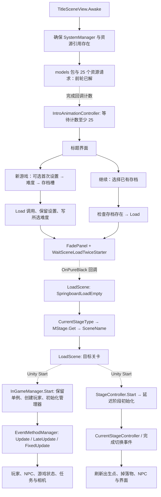

# 标题进入游戏：场景切换、初始化与每帧入口

本轮继续对固定构建的原始 `GameAssembly.dll` 使用 REA/Ghidra 静态分析，并交叉读取原始 `data.unity3d` 的场景、按钮与配置对象。**已经连接标题按钮到游戏场景和主要初始化入口；尚未产出可独立编译运行的游戏。**没有启动游戏、执行游戏程序集或改写原始目录。

机器可复查坐标见 [`salt/evidence/scene-chain.json`](salt/evidence/scene-chain.json)，资源证据见 [`assets/scene-inventory.json`](assets/scene-inventory.json)。新增 **109 次非空函数查询，覆盖 108 个唯一地址 / 108 个唯一 Evidence ID**，分为 `scene-entry/state/init/readiness/loop/engine` 六批；共享入口的重复查询不计作独立函数。原始 REA 记录及 profile、种子、关闭状态保留在各批目录。复用此前 7 条入口观察；`InGameManager.Start` 另以新增的 Assembly-CSharp 种子分析，以减少未命名调用。共享地址的多个方法名仍保留为别名。

## 总体路径



虚线表示静态代码支持的回调/生命周期关系，**不表示本轮观察到了其运行时发生顺序**。两个场景各自的 `Start` 不能仅凭反编译文件的排列确定先后。

## 1. 标题入口、资源就绪与持久资源

- `TitleSceneView.Awake`（16362，前轮记录）包含 `SystemManager.CreateIfNoExist` 的逻辑：已有有效实例则复用，否则 `Resources.Load("SystemManager")` 后实例化。新查询 17433/17434 确认独立入口及其 `Awake`。
- 原始 ResourceManager 的 `systemmanager` 项与 SystemManager prefab、子物体 AssetReferencer 的 PPtr 链在资源 JSON 中保存。关卡配置不能仅从标题场景那个 AssetReferencer 的字段判断：标题场景副本的 MStage 指针为空，SystemManager prefab 与公寓内的引用则指向真实 MStage 对象。
- `AssetReferencer.Awake`（15829）在旧实例仍有效时销毁自己的 GameObject，否则设置静态 `instance`。`SystemManager.Awake` 与 `InGameManager.Start` 的持久化逻辑需要一并重建，才能保留此前请求写入的玩家/材质资源。
- `IntroAnimationController.OnEndFadeOut`（13822）把 phase 写为 **3**；`Update`（13818）在 phase 3 取得标题对象，检查 `TitleSceneView.IsEndLoadCount +0xb4`：小于 **25** 时返回，达到阈值后触发 Animator 的 **`TransTitle`**，phase 变为 **4**。这是前轮尚未建立的“25 次回调→标题动画继续”连接。

前轮已证实每个资源回调**先增加计数，再做类型检查与缓存写入**；所以该阈值不是“25 个资源都成功有效”的校验。`Awake` 的实际排序、动画事件何时调用这些入口仍需运行或完整动画配置佐证。

## 2. 新游戏与继续游戏不走同一套前置步骤

### 新游戏

1. `TitleSceneView.OnClickNewGame`（16369）设 `isOpenChild +0xb0=true`。若设置中的 `AnsweredFirstSexOption`（OptionData `+0xbd`）尚未回答，且非 trial，则打开首次选项面板；否则直接打开难度面板。
2. `SelectSexOptionPanelView.OnClickDecide`（17537）标记已回答，安排延迟回调 17542；其保存的 Action 回到标题 `<OnClickNewGame>b__37_0`（16402），再打开难度面板。不是这个回调本身加载场景。
3. `SelectDifficultyPanelView.OnClickDecide`（17552）区分 `isFromSystemMenu`：标题入口为 false，打开 **ManualSavePanelView** 并传递所选难度；从游戏系统菜单打开时只改当前难度，不进入新游戏场景。
4. `ManualSavePanelView.OnClickSlot`（17842）查存档是否存在：空槽调用 `OnSelect`（17853）；已有存档打开确认弹窗。相关确认/延迟委托 17854/17855/17856 已解析，17856 的代码先删除该槽文件再继续。因此重建时必须保留这个条件，不能点槽即覆盖。
5. `OnSelect` 保存旧 `GameState.OptionData`，写 `SaveManager.CurrentSlot`，调用 `SaveManager.Load(5, slot)`，恢复原来的 OptionData，然后把选择写入 `GameState.GameStateData.DifficultType +0x34`。
6. 创建 `WaitSceneLoadTwiceStarter`，打开 FadePanel。黑屏回调 17850 调用场景加载入口，场景名为 **`SpringboardLoadEmpty`**；完成淡入回调 17851 是空方法。

这里 **5 是原始调用实参，不据此声称 Load 会完全绕过磁盘**。REA 的 `SaveManager.Load` 仍显示默认对象构造和 ES3 读取；新游戏默认状态还依赖空槽或确认后删除旧槽的路径。

### 继续游戏

`OnClickContinue`（16370）打开 SaveDataSelectPanel；`OnClickItem`（17861）只有在 `IsExistSaveData(category, slot)` 为真时，才写槽号、调用 `SaveManager.Load(category, slot)` 并进入 `TransScene`（17860）。

`TransScene` 在已有 InGameManager 时先停止状态应用，创建同样的 `WaitSceneLoadTwiceStarter`，再打开 FadePanel。其黑屏 Action（17869）先广播 **ExitInGameEvent**，再加载 `SpringboardLoadEmpty`。此路径同时可用于从已有游戏状态重新载入，不能只实现为标题按钮的直接场景跳转。

### 状态恢复的已知边界

`SaveManager.Load`（16971）先 `LoadSystem`（16969）；category=4 时到此返回。其余路径创建默认 PlayerCustomData、GameStateData，按 `PlayerCustomData`、`GameStateData`、`SaveDataSlotIndex` 等键读取，再处理缺省配置与兼容数据。

原生辅助函数 `0x1809fef00` 继续通向 ES3Settings、ES3Reader/ES3File 的读取分支；已有默认值可在缺数据路径返回。泛型 MethodSpec、键名、声明参数和原始字节都保存在 scene-chain JSON。**ES3 全部类型序列化、历史存档迁移和每项默认值的完整重实现仍未完成。**

## 3. 两次场景加载、淡出等待与 Unity 边界

`SpringboardLoadEmpty.Start`（16466）执行：

```text
TimeScaleManager.SwitchMode(0, false)
SpringboardLoadEmpty.IsPathSpringboardOnce = true
stage = GameState.GameStateData.CurrentStageType       // 实例 +0x10
record = MStage.Get(stage)
SceneManager.LoadScene(record.SceneName)               // MStageRecord +0x20
```

`MStage.CheckInitialize`（15985）从 AssetReferencer.MStage 的 stages 数组建立按 StageType 索引的字典与列表；`Get`（15986）按枚举查询。场景名与目录、枚举值不能相互猜测。

原始 BuildSettings（`globalgamemanagers`, class141, pathID **11**, 解压流偏移 **167304**, **844B**）含 10 个有序场景路径。下表把路径顺序、levelN 中 StageController 的原始枚举值与 MStage 配置交叉列出；完整路径和原始对象在资源 JSON 中。

| 构建序号 / 节点 | 场景名 | StageType |
| --- | --- | --- |
| 0 / level0 | Title | 标题 |
| 1 / level1 | Apartment | Apart = 0 |
| 2 / level2 | Konbini | Convenience = 6 |
| 3 / level3 | StationFront | StationFront = 12 |
| 4 / level4 | Mall | ShoppingMall = 11 |
| 5 / level5 | MyPark | Park = 14 |
| 6 / level6 | Fashion_shop | FashionShop = 7 |
| 7 / level7 | Mansion | Mansion = 15 |
| 8 / level8 | Night_Demo 1 | Residence = 10 |
| 9 / level9 | SpringboardLoadEmpty | 过渡入口 |

特别是含 `Tokyo_Street` 的场景路径，StageType 为 **Residence=10**，不能据目录写成 TokyoStreet=1。levelN 对应 BuildSettings 的顺序采用此播放器的标准布局，并由端点入口组件和 Stage 配置交叉支持；没有另行发现一张显式 level→path 映射表。

加载链继续到 `SceneManager.LoadSceneAsyncNameIndexInternal`（49945）→当前 SceneManagerAPI 的虚调用；默认 API 实现为 `LoadSceneAsyncByNameOrIndex`（49939）→APIInternal（49934/49935）→具名引擎 ICall。`get_ActiveAPI` 优先选择非空 override；本轮没有观察实际运行时 override 值。**内部函数名带 Async 不等于上层调用的是公开的 LoadSceneAsync**：本路径传入 `sceneBuildIndex=-1`、Single 参数值 0、`mustCompleteNextFrame=true`；公开同步与异步 wrapper 的区别由 scene-engine 批次单独保留。UnityPlayer 的场景反序列化及生命周期实现没有在本轮反编译。

淡出协议：

- `FadePanelView.Initialize`（18321）保存 starter、onPureBlack、onStartFadeIn、onCompleteFade，并设置实例/Animator。
- `OnPureBlack`（18323）设 `isAlreadyOnPureBlack +0x48=true` 后调用场景切换 Action。
- `WaitSceneLoadTwiceStarter`（18343/18345）订阅 Unity `sceneLoaded`，每次加计数 `+0x10`；计数 **>1** 时退订并设 ready `+0x14=true`。它不筛选特定场景，因此重建时不能误写成“收到任意一次即可”。
- FadePanel.Update（18322）通过 **IFadeInStarter 槽0→类槽4→18344** 查询 ready；仅在黑屏且未安排过时，安排延迟 Action（18328）触发淡入。`OnExitAnim`（18324）调用完成 Action 并销毁面板。
- `DelayFrameModel.CountdownAndInvokeIfNeed`（17307）在计数非零时只减一并返回；计数已经为零才调用 Action。`DelayFlame(1/2)` 不能直接翻译成毫秒延迟；首次处理时机还取决于 Scheduler.Update 的队列处理。

## 4. 游戏对象初始化与关卡接入

原始公寓场景中，InGameManager 和 InGameReferencer 挂在同一根 GameObject；SystemManager 是另一根对象，AssetReferencer 位于其子物体。过渡场景入口是根 `SceneController` 上的 SpringboardLoadEmpty。资源中持久化的 enabled/active 与脚本身份已核对，不等于执行验证。

`InGameManager.Start`（16862）的主要顺序与条件：

1. 若静态 `isExist +0x8` 已真，销毁重复对象并返回；否则 DontDestroyOnLoad、设置 Instance/isExist。
2. 若 `IsPathSpringboardOnce` 为 false，执行 `Load(5,0)` 的直接进入场景分支；正常经 Springboard 进入时复用已准备状态。
3. 构造 StageTransController、DroppedItemManager、TemporaryInGameState、MissionManager、GameStateApplier 等对象；获取场景 InGameReferencer/EventMethodManager。
4. 从 `AssetReferencer.Player +0x348` 克隆玩家到指定父物体，GetComponent<PlayerController> 后存到 `InGameReferencer.Player +0x30`。前轮已绑定该泛型实例和 Unity 克隆边界。
5. 玩家引用设置后，初始化 EventMethodManager、MissionManager、InGameEventListener/GameStateApplier，并注册交互、时间变化、GameOver、开始切换等监听器。再执行 PlayerController.Initialize（14756），传入五个声明参数：FaceCamera、TP Camera、FP Camera、BaseCamera、DroppedItemManager。随后初始化面部相机、InGameUiManager（15841）、BaseCamera、SlowAssist、UI Player、Drone、选项和画面应用器等。
6. 根据当前 StageController 与保存的 CurrentStageType 是否一致，恢复保存的位置/旋转或调整当前关卡状态；重置 TP Camera，安排 `<Start>b__52_0`（16868），原始延迟参数为 **2**；加载输入重绑定配置。
7. 延迟回调按 debug 条件调用 NpcManager.OnLoadData 或 RepopNpc，显示当前关卡名称；部分初始关卡逻辑继续写入玩家状态。

`StageController.Start`（17052）另行安排延迟参数 **1** 的 17063，并监听 ChangeTimeEvent。17063 初始化随机位置相关对象、设置 `InGameManager.CurrentStageController +0x40`，在 `TemporaryInGameState.IsFirstLoadStage +0x12` 为 false 时广播 **CompleteTransitionStageEvent**，之后把该标志清零，再处理镜面、BGM，并继续安排 17064。

17064 处理该场景存在的对话/坐姿/门铃 NPC、便利店、电梯、厕所、灯光贴图及昼夜外观等初始化。它包含多个可选组件分支，不能把所有子系统都当作每个场景必有。

`InGameEventListener.Initialize`（16823）注册 CompleteTransitionStageEvent、ExitInGameEvent 和 FoundStrangerEvent。完成切换处理（16825）连接到关卡出生点、Player.Warp、掉落物激活、NPC 重生与场景名界面。它与初次 Start 的 NPC 回调是两条有关联的入口，不能合并成无条件执行两遍。

上述初始化已定位主要依赖、调用者和部分函数体；任务规则、所有 NPC 状态机、玩家移动/交互/物理和相机完整逻辑仍需逐层补全。

## 5. 接入游戏循环所需的真实分派

不能指望 Unity 按名字自动调用 `OnUpdate`。`EventMethodManager.Initialize`（16734）保存 InGameReferencer，建立更新列表：

- IUpdater 列表含 CursorController、InGameManager、Player、NpcManager、SlowAssistManager。
- ILateUpdater 列表含 Player、NpcManager、InGameUiManager、InGameManager。
- IStarter 列表加入 TP Camera，并由 OnStart（16735）调用其接口入口。

其 Unity `Update`（16737）先处理输入再遍历 IUpdater 槽0；`LateUpdate`（16738）遍历 ILateUpdater 槽0并处理相机；`FixedUpdate`（16736）连接玩家和 NPC 的 locomotion 固定步长入口。

原始 interfaceOffsets/vtable 已验证：

| 接收类与接口 | 接口槽 | 类槽 | 实际方法 |
| --- | ---: | ---: | --- |
| InGameManager / IUpdater | 0 | 4 | 16864 OnUpdate |
| InGameManager / ILateUpdater | 0 | 5 | 16865 OnLateUpdate |
| PlayerController / IUpdater | 0 | 4 | 14757 OnUpdate |
| WaitSceneLoadTwiceStarter / IFadeInStarter | 0 | 4 | 18344 IsStart |

InGameManager.OnUpdate 继续进入状态/事件和选定子系统更新；OnLateUpdate 连接任务和 GameStateApplier。PlayerController.Initialize、OnUpdate 的函数体也已保存。这里建立的是循环入口与分派，**不是所有子状态逻辑已经可替代原 DLL**。

## 6. 复查入口与剩余工作

```powershell
python reverse-engineering/assets/inspect_scenes.py --check
python reverse-engineering/salt/scene_evidence.py --check
python reverse-engineering/audit.py --inputs

# 重跑某一已保存计划（会重新建立并关闭独立 REA 会话）
node reverse-engineering/salt/run_batch.mjs reverse-engineering/salt/symbols/scene-entry.plan.json
```

`scene_evidence.py` 验证原始 native/metadata 指纹、每批成功与关闭状态、选定方法的原始定义和签名、usage/字符串/泛型 MethodSpec、注册字段偏移，以及上表接口分派。JSON 中的 `pseudocode_method_references` 明确包含内联/尾调用展开；字节 E8 匹配只作指定 unwind 范围内的候选佐证，未冒充完整独立指令解码。

核心 REA Evidence ID（其余按 method ID 查 JSON）：

| 入口 | Evidence ID |
| --- | --- |
| 13818 标题计数门槛 | `ev_eabfdd5690629c2aed19233462b3bef956dd579bcceda93440c274216a921f51` |
| 17853 新游戏槽确认 | `ev_380da12fc55f41c635d5db70880507b219eeecb7c11ebe354f89fabc667254bc` |
| 17869 继续游戏黑屏回调 | `ev_93121eaa028cb40a970d9adb15f0be3d519c314abbc1cc0ffc98af672aabe2fa` |
| 16466 过渡场景 Start | `ev_1a0d339c13439fb98d775f60afd9a96d22509f8fcb35299d8e5e086e0ed9d3e4` |
| 16862 游戏初始化 | `ev_83b19736e5bb46053db530ad6ca8acca0ec9ec256a62b7014e1348d72966e2ac` |
| 17063 关卡延迟初始化 | `ev_c6ee73cfdcb147d478444dd2324ebf5fa92b42ee236d1f358236cd95295b5212` |
| 16737 Update 分派 | `ev_68f69535b042bdbca06d9b824f79f2f07253beec3dc12e5ce7b39c6056c0f183` |
| 16738 LateUpdate 分派 | `ev_ed6ce232cea2f62a06429266cef37575927f60f04da8efd461abc0d751f1d828` |

优先问题的状态：标题按钮→存档/默认状态→过渡→目标场景、主要 Start 初始化、延迟回调和每帧入口 **已在本构建静态范围连接**；按钮绑定、场景配置和资源 prefab 有原始对象证据。完整动画事件/Animator 状态机、Awake/Start/Scheduler 的实际跨对象顺序、ES3 全序列化及玩法子状态机 **仍未完整恢复**。

下一阶段应从 PlayerLocomotion / NPC 更新、MissionManager 规则和 GameStateApplier 的状态应用继续，同时恢复可用于 Unity 工程的对象/组件/动画配置与接口实现。当前交付仍是重建依据，未完成独立可运行版本，也未进行启动测试。
