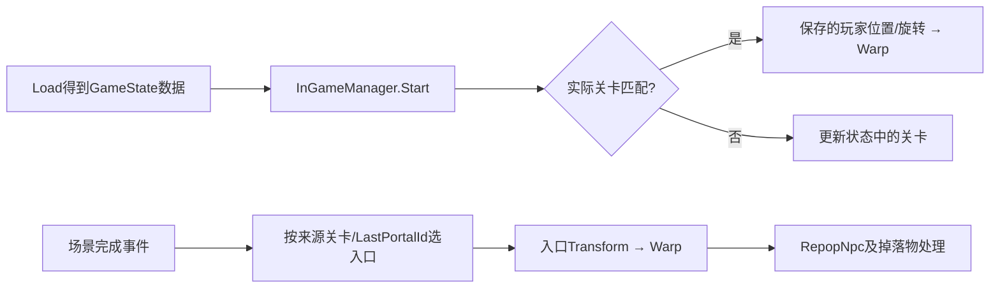

# 存档到运行对象：NPC、掉落物与玩家初始化

2026-10-27，按优先级推进读档恢复。本轮新增 **50次非空REA/Ghidra查询、50个不同地址/Evidence ID**：`state-restore-core` 31、`tail` 19，复用21份旧观察。绑定357个usage及选定类型字段；另用原始PE/Iced核验NPC两处浮点延迟实参，共557条指令。所有输入保持只读，两个REA会话均已导出并关闭。

结果是选定恢复链及输入覆盖，不是原生对象保存/加载往返，也没有生成独立游戏。

## 1. 玩家位置恢复与场景转移

复用 `SaveManager.Load`（16971）、`InGameManager.Start`（16862）、玩家初始化和Warp：Load首先得到状态数据，Start随后将实际 StageController 的关卡与 `GameStateData.CurrentStageType +0x10` 比较。相同时，通过 `PlayerController.Warp` 使用保存的 `PlayerPosition +0x180` 和 `PlayerRotation +0x18c`；不匹配时更新状态中的关卡，而不是把另一关的存档坐标无条件套入当前场景。

场景完成通知 `OnCompleteTransitionStageEvent`（16825）是另一条路径。新增 `StageController.GetSpawnPoint`（17059）按 fromStageType 和 `StageTransController.LastPortalId` 匹配 PortalManager 中的入口，未找到时可返回空。调用方取入口Transform的坐标/旋转Warp玩家，并推进NPC重生、预留掉落与激活；不能随意拿第一个出生点代替匹配过程。



图中是选定调用和守卫，不代表已测量全部MonoBehaviour/Scheduler的运行次序。

## 2. NPC读档与重新生成的区别

启动回调16868检查的是 **DebugController.IsForceCreateNpc +0x0b**，并非“新游戏标志”。关闭强制生成时调用 `NpcManager.OnLoadData`（15583）；开启时先清fixedNpcCount，再进入RepopNpc。

OnLoadData先写 `isLoadedData +0x65 = true`，逐项读取 `GameStateData.NpcSaveDataList +0x40`，只继续处理 `NpcSaveData.IsExist +0x2c` 为真的记录。若ElevatorController存在，且其 `PushBounds +0x5c` 包含保存位置，该记录不排入恢复队列；其他符合条件的记录以闭包保存**记录引用**和manager，经DelayUnscaledTime排队。空列表直接结束，选定函数没有自动调用RepopNpc补刷。

闭包15605已补查，进入 `InstantiateNpc(npcSaveData=记录, isRandomPathSpawn=false, fixedType=0)`；继续连接原有InstantiateNpc15587、NpcController.Initialize15518。保存位置/旋转进入新增核对的 `NpcController.Warp`（15531），该方法依次写Transform位置、旋转，并对NavMeshAgent调用Warp。

`OnLoadStage`（15582）则清fixedNpcCount后进入 `RepopNpc`（15585）。后者销毁原ExistNpcList中的控制器、清列表与对象字典、清spawnNum，读取当前关卡/时间/难度与选项确定生成数量，并排队闭包15603。它调用 `InstantiateNpc(null, true, 0)`，属于随机路径生成。固定NPC的AdditionalInitializeForFixAction及回调15539另行绑定，不能把所有NPC按同一记录还原。

### 浮点延迟

OnLoadData与RepopNpc均把 **Random.value返回的XMM0直接移到XMM1**，传入Scheduler.DelayUnscaledTime。两个调用窗口分别在RVA `0x42f6e4..0x42f6f2`、`0x42fda3..0x42fdae`；没有在这段搬运间乘以循环索引或其他倍率。不能把缺失浮点参数的伪代码解释成“固定一帧”或“按生成序号逐次延迟”。

完整两个PE unwind片段、`.pdata`/unwind原始字节及557条指令见 [state-restore-instructions.json](salt/symbols/state-restore-instructions.json)。这是静态ABI核验，没有测量实际生成时间。

## 3. 掉落物恢复与状态副作用

新增构造、激活、Drop/Hide/Collect/ReserveDrop/SendToHome及预留回调。`ActiveDroppedItemIfNeed`（16727）遍历 `DropDataDict +0x18`：

| 保存记录条件 | 选定循环的动作 |
| --- | --- |
| IsDropped=false | 不调用Drop/Hide |
| IsDropped=true，StageType匹配当前关卡 | 用保存Position/Rotation/ItemType调用Drop |
| IsDropped=true，StageType不同 | 调用Hide |

Drop（16712）不仅激活缓存对象并设置Transform，也会把IsDropped、位置、旋转和当前关卡写回记录。Hide（16717）通过GetCache关闭对象，不清IsDropped；隐藏与收取不是同一状态变化。Collect（16720）的一般路径会清IsDropped，ItemType=2另进FashionShop的篮子保存分支。SendToHome（16716）设置IsDropped、读取MCommon中的自宅投放位置并把StageType写为0，选定函数没有直接关闭当前模型。

ReserveDrop（16715）另建记录，设置IsReserve并加入 `ReserveDropList +0x28`。ApplyReserveDropIfNeed（16711）逐条调用16732：不匹配当前关卡返回false；匹配时先清IsReserve，再选择相对玩家的随机位置、读取Transform、Drop并注册罗盘目标；返回true的记录从预留列表删除。随机位置/对象为空时的错误路径没有被重建成静默成功或无条件删除。

构造函数的伪代码可能跟随尾调用展开同一激活循环，绑定保留这个边界，没有把它当作额外的一次同步激活。Dispose16708只看到转入共享辅助；完整缓存/场景销毁与异常中断处理仍须运行核对。

## 4. 玩家外观事件的接收器

`PlayerController.Initialize`（14756）完成类访问器/组件初始化后安排14769。该回调广播 `Events.ChangeBodyEvent +0x60`，然后将 `PlayerBodyCustomizeAdjuster.MoveSpeed +0xb0` 复制到 `PlayerAnimationManager.baseMoveSpeed +0x24`，因此它不只是“初始化完成通知”。

本轮补齐五组初始化/监听/消费者，均有原始 **AddListener<ChangeBodyEvent> MethodSpec** 与对应委托usage，不是靠方法名猜订阅关系：

| 初始化 | 接收方法 | 选定作用 |
| --- | --- | --- |
| 14598 | 14602 PlayerBodyCustomizeAdjuster.OnChangeBody | 读取PlayerCustomData，更新体型/Transform及相关调整值 |
| 14620 | 14625 PlayerBodyMaterialController.OnChangeBody | 转入14624，按保存的BodyPaint等配置应用身体材质 |
| 14630 | 14632 PlayerBoneScaleAdjuster.OnChangeBody | 再延迟一帧进入14636，按父对象缩放调整自身 |
| 14840 | 14847 PlayerFaceController.OnChangeBody | 从自定义字段恢复选定脸部/材质配置 |
| 15074 | 15075 HairCustomAdjuster.OnChangeBody | 按头发定制数据更新选定材质；初始化有一次性守卫 |

这些接收器说明保存字段如何进入选定表现对象，但不代表全部66个PlayerCustomData字段、所有模型或物理结果都已运行验证。外观预设构造时读取当前自定义对象的上下文依赖仍按 [save-schema.md](save-schema.md) 保留。

另确认默认Loadout两类工厂16813/16814各创建20项，而已有Load兼容分支按其循环条件补到21项。7份样本两类列表均为21；独立实现不能擅自统一两处原始循环。

## 5. 固定存档样本实际覆盖

新脚本 [restore_inputs.py](salt/restore_inputs.py) 从此前8份固定加密快照重新只读解码，筛出7份游戏档，校验存储姿态的有限float32可表示性、记录字段/类型和数字字典键身份，并投影上述掉落守卫。明文和实际坐标没有写入归档。

| 项目 | 本批覆盖 |
| --- | --- |
| 游戏快照 | 7 |
| NPC记录 / 预留掉落记录 | 0 / 0 |
| DropDataDict记录 | 196 |
| IsDropped=false | 193 |
| 已掉落、其他场景→Hide分支输入 | 3，仅一份备份中存在 |
| 已掉落、当前场景→Drop分支输入 | 0 |
| LoadoutDatas / LoadoutCustomizeDatas | 每份均21 / 21 |

因此本批不能验证非空NPC恢复、当前场景掉落物激活或预留投放，更不能把守卫计数当成实际执行次数。3项专项测试中的非空NPC和三种掉落分支均为**合成结构示例**，不计入自然或原生运行覆盖。结果见 [state-restore-inputs.json](salt/evidence/state-restore-inputs.json)。

## 6. 当前完成与后续优先级

本批选定NPC、掉落物、玩家位置和五类外观消费者已补齐静态调用链；完整绑定见 [state-restore-chain.json](salt/evidence/state-restore-chain.json)。保留以下关键缺口：

1. 含有效NPC、当前场景已掉落物和预留记录的原生读档回归，以及保存→加载→对象状态对照。
2. 排队恢复期间转场/销毁的取消机制、引用捕获后的状态变化和完整清理；本批没有证明存在或不存在错误。
3. 全部存档字段/引用、外观/物理结果和历史兼容恢复。
4. 按此前排序继续补场景昼夜/刷新、物品全生命周期、技能/RP和任务闭环；最小可编译重建工程仍未交付。

复核：

```powershell
python reverse-engineering/salt/restore_inputs.py --check
python reverse-engineering/salt/test_restore_inputs.py
python reverse-engineering/salt/restore_evidence.py --check
python reverse-engineering/audit.py --inputs
```
